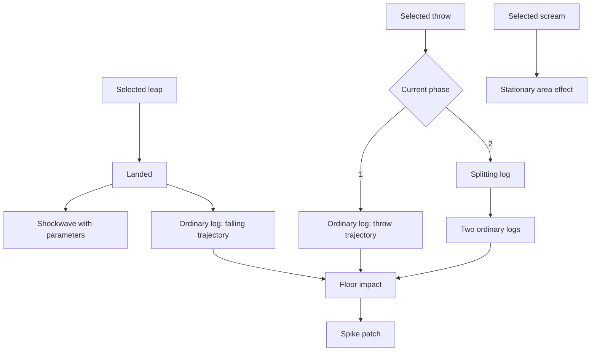

# Modular mechanics and world-content plan

Status: proposed implementation plan, 2026-11-03. No gameplay or room changes are made by this document. Start with the Ape vertical slice; later milestones depend on its small shared primitives.

Implementation checkpoint: the first Ape slice now has extracted projectile/area
primitives, explicit trigger-only bindings, shared falling/thrown logs, apex splitting,
editable health/phase entry, and regression tests. See [the catalogue guide](ATTACK_CATALOG.md#ape-phases-and-consequences).
New checkpoint 2026-11-05: family health editing, extracted floor/crawler/brood
foundations, and [room-editor patrol authoring](PATROL_AUTHORING.md) are implemented.
Movable bodies support surface/sticky and open/closed paths, runtime collision,
point editing, previews and safe room round-trips. Traps, generic trigger links,
inventory and the later terrain/content passes remain pending.

The general attack runner, configurable event-graph authoring, and later milestones
remain planned; this checkpoint does not mark the entire architecture programme complete.

New direction, 2026-11-04: the game is **Bethe Knight**, with Be as protagonist.
The [Kraken, three-stat progression and Enemy-tab review proposal](BETHE_KNIGHT_DESIGN.md)
extend this programme. Kraken/ability balance remains design work; no new boss or
stat nerfs are implied by the implemented title change. The current combined Ape
page intentionally omits redundant right-side phase boxes.

## 1. What the current code tells us

Inspected: `scripts/entities.gd`, `world.gd`, `player.gd`, `adventure.gd`, `map_view.gd`, `attack_catalog.gd`, and the two attack CSVs.

- `entities.gd` has 3,389 lines and combines registry, base entity, enemies, hazards, interactables, projectiles, and Ape encounter behavior. `world.gd` has 1,503 lines; `player.gd` has 2,165. Size identifies extraction candidates; it does not by itself prove a bug.
- Entities inherit `RefCounted`; World explicitly updates, collides, and draws them. Preserve this lifecycle and pixel collision initially. Converting everything to `CharacterBody2D` would introduce an unrelated physics migration.
- The player already has explicit movement states. Extract their responsibilities incrementally, preserving update order, timers, collision callbacks, and the 60 Hz timestep.
- At the initial audit the Ape had hardcoded HP/phase thresholds and embedded projectile collections. The implemented slice now uses editable health/phase-entry profiles and extracted projectile/area effects; encounter decisions still live in `entities.gd`. Its CSV/profile integration is the migration seam.
- The paused menu already has Map and Monsters tabs. Inventory belongs alongside them.
- Run data already tracks abilities, pickups, discovery, and kills; inventory and event progress should extend that schema, rather than create a second save system.
- Current `BreakWall.hit()` subtracts one HP per hit. The requested damage-based heavy walls therefore require a real damage contract; merely renaming current HP would not make stronger attacks work.

## 2. Research and architectural decisions

These are primary manuals and educational sources consulted for this plan:

| Source | What it provides | Application in Bethe Knight |
| --- | --- | --- |
| [Godot: scene organization](https://docs.godotengine.org/en/stable/tutorials/best_practices/scene_organization.html) | Focused objects, explicit injected dependencies, and parent-mediated relationships | World supplies collision/spawn services; effects do not search unrelated game objects |
| [Godot: Resources](https://docs.godotengine.org/en/stable/classes/class_resource.html) | Engine-supported data containers | Compile authored CSV/JSON into validated definitions; keep mutable runtime state separate |
| [Game Programming Patterns: Component](https://gameprogrammingpatterns.com/component.html) | Separating behavioral domains through composition | Reuse motion, health, attack execution, and spawning without building a subclass for every combination |
| [GDQuest: finite state machines in Godot 4](https://www.gdquest.com/tutorial/godot/design-patterns/finite-state-machine/) and [companion demos](https://github.com/gdquest-demos/godot-design-patterns) | A practical FSM tutorial and examples | Explicit enter/update/exit contracts for actors; adapt to Bethe Knight's existing RefCounted simulation |
| [GDC: Designing Celeste](https://www.gdcvault.com/play/1024307/Level-Design-Workshop-Designing-Celeste) / [official video](https://www.youtube.com/watch?v=4RlpMhBKNr0) | A developer talk about stage design, arranging area maps, and story | Reference when iterating teaching rooms, optional routes, and encounter pacing |

The proposed structure below is our project-specific design, not a claim that those sources prescribe this exact system. File separation alone is insufficient: each module needs an owner, a small interface, testable inputs, and an explicit lifetime.

### Module boundaries

Proposed directories are destinations for gradual extraction, not an instruction to move every file immediately.

| Module | Owns | Must obtain through an interface |
| --- | --- | --- |
| `scripts/actors/` | Actor body, health, enemy decisions, phase controller | Collision queries, target snapshot, attack runner |
| `scripts/combat/` | Attack definitions/selection/execution, damage requests, effect spawning | Actor pose and room services |
| `scripts/effects/` | Projectiles, impact effects, explosions, attached weapons | Owner handle, movement/collision services, authored definition |
| `scripts/motion/` | Surface motion, path motion, charge movement | Support queries, displacement/collision adapter |
| `scripts/interaction/` | Triggers, conditions, interactables, inventory transactions | Read-only progress context and explicit commands |
| `scripts/player/` | Movement states, power-up modules, player combat | Existing pixel mover, input snapshot, ability registry |
| `scripts/world/` | Room lifecycle, terrain queries, connections, discovery | Content definitions and saved progress |
| `scripts/story/events/` | Named one-time encounter scripts and event definitions | Typed room/actor events and progress transactions |
| `scripts/presentation/` | Environment skins, ornaments, animation/audio responses | Simulation snapshots/events; no progression decisions |
| Existing editor scripts | Authoring and previews | The same schemas, validators, and definition loaders as runtime |

Keep `entities.gd` as a compatibility registry/factory while implementations leave it. Keep `world.gd` as the coordinator while extracting services. Avoid a universal manager that knows every mechanic, and avoid a global event bus for local attack chains.

Definitions are immutable during an attack. Runtime instances hold timers, velocity, hit sets, owner IDs, and phase state. An editor change applies on the next attack/preview restart, without changing an in-flight attack halfway through execution.

## 3. First milestone: deconstruct the Ape

### Selectable attacks versus consequences

Introduce `activation_mode = selected | triggered`. Both are visible in the Ape Enemy tab; triggered entries appear last with a clear “Triggered by…” label and editable parameters. Triggered entries never enter range/chance selection. A skip chance of 100% is a selection rule, not an adequate representation of an effect.

| Entry | Activation | Behavior / outgoing event |
| --- | --- | --- |
| Leap | Selected | Existing pixel leap; `landed` spawns shockwave and falling log |
| Throw log | Selected | Spawns the same ordinary log with a throw trajectory |
| Scream | Selected | Spawns a stationary area effect during its active window |
| In-place leap sequence | Phase-entry script | Reuses leap with target = current position; per-landing wave parameters |
| Shockwave | Triggered | Ground-aligned damage region; width/height/lifetime are parameters |
| Ordinary log | Triggered | Moves using its initial conditions; first valid floor impact spawns spikes |
| Splitting log | Triggered | At its authored split event spawns two ordinary logs, then ends |
| Floor spike patch | Triggered | Shared landing consequence of ordinary logs |

The log archetype owns floor-impact behavior, not the Ape. Falling and thrown ordinary logs differ only in spawn pose, initial velocity, gravity/trajectory profile, and optional warning. Both use the same collision, appearance, damage, and spike-spawn logic. The splitting variant references ordinary children, preventing accidental infinite splitting.

### Small execution contracts

- `AttackSelector.choose(context)` returns the first eligible selected binding in existing descending priority order; preserve stable CSV tie order and existing range boundaries. A deliberately empty loadout means no attacks.
- `AttackRunner.start(definition, context)` owns wind-up, execution, recovery, cancellation, and one immutable parameter snapshot.
- `EffectSpawner.spawn(effect_id, spawn_context)` creates a room-owned effect with a source actor, faction, transform, trajectory, and lifetime policy.
- Typed local events include `landed`, `floor_impacted`, `split_reached`, `expired`, `owner_died`, and `phase_entered`. Events carry a source instance ID and are emitted once per transition.
- `DamageRequest` carries source, attack instance, amount, direction, and hit category. A target records hits by attack instance so an active hitbox cannot count as many separate swings.
- Attached effects disappear on owner cancellation/death. Detached projectiles normally finish after owner death; encounter reset cancels all encounter-owned effects. Persistent aftermath such as intended spike patches needs an explicit persistence rule.
- Defer spawn/removal until safe iteration boundaries. Effects created this tick have a defined first-update tick. Bound chain depth and children per event; reject invalid/cyclic definitions during validation.

### Data and editor changes

Keep `attacks.csv` and `enemy_attacks.csv` authoritative for their current fields. Proposed additions:

| File | New responsibility |
| --- | --- |
| `data/enemies.csv` | Enemy HP, hitbox, motion profile, death-effect/drop references |
| `data/enemy_phases.csv` | Enemy/phase IDs, HP threshold, loadout, entry sequence, phase priority |
| `data/attack_effects.csv` | Parent attack/effect ID, source event, child effect ID, count, spawn profile, condition |
| `data/effect_profiles.json` | Structured trajectories, attached shapes, bounded sequences, per-step parameters |

Add `activation_mode` to bindings or expose an equivalent validated field; keep classification separate from the existing attack damage type. Use stable IDs independently of editable names. Migrate legacy `ape_slam`, `ape_log`, `ape_split`, and `follow_up` references through explicit adapters. Do not maintain two writable representations of the same chain.

The Enemy tab gains grouped **Stats / Phases / Motion / Selected attacks / Triggered effects / On death** sections. Child effects are editable there through the same definitions, with shared-definition warnings and “duplicate variant” when independent tuning is desired. Preserve lazy detail construction, compact grouping, two-decimal authored values, undo/dirty handling, validation, and web exclusion of authoring tools.

Existing attack scoring remains a separate service. Show direct score and consequence-chain contribution separately; do not count trigger-only effects as independent AI choices. Define whether repeated children sum and how phase loadouts are summarized before changing totals. Preserve the existing omnidirectional/multishot policy and flag effects the formula cannot yet score, such as initially stationary falling objects; do not invent zero or infinite scores.

### Phases and shockwaves

Expose `max_hp`, phase threshold, phase loadout, entry sequence, and relevant cooldowns. Give combat phase a separate name from action state: “phase 2” must not share a variable with “wind-up / airborne / recovering”. Phase transitions fire exactly once; a large damage hit that crosses several thresholds follows a documented priority. Death takes priority over starting a phase-entry sequence.

Recommendation: one shockwave implementation with parameters, and a short authored in-place-leap sequence containing a list of wave scales. Separate named presets are useful for reuse, but three duplicated shockwave scripts are unnecessary. A growing radial wave and a larger stationary rectangle are different mechanics: preserve current ground-wave behavior unless deliberately redesigned.

**Working interpretation:** phase 2 begins with the in-place leap sequence instead of an opening throw, then uses splitting-log throws normally. The precise hop count, scale list, and splitting moment remain tuning decisions. Current code adds hops after enraged screams; migration must explicitly replace or retain that behavior rather than accidentally combine both sequences.

### Efficient decisions

Compile and priority-sort loadouts on load/edit, excluding triggered entries. At an attack decision boundary, compute player-relative position once, test cheap phase/range/cooldown conditions, then expensive LOS if required, then roll chance once. Stop at the first eligible attack. Existing skip cooldown semantics must survive migration; do not reroll every physics frame.

Do not delay collision, fuse, or landing detection to an AI decision interval: these remain at 60 Hz with swept movement where necessary. Use room-local lists and existing spatial collision indexing. Profile before introducing pooling or a general scheduler.

**Ape acceptance:** editor can change HP/phase threshold; only selected attacks are selected; one landing creates exactly one intended consequence chain; falling/thrown logs produce identical impact results; a split creates exactly two ordinary children; scream active area matches its preview; phase entry cannot repeat; reset/death/room exit leave no stray hitboxes; existing arena gates and aftermath remain correct.

## 4. Shared conditions, triggers, motion, and traps

### Conditions and triggers

Use a small validated condition tree: `all`, `any`, `not`, `has_item`, `has_ability`, `flag`, `quest_state`, and actor/phase filters. Conditions read a supplied context and return a result with a reason for editor/debug display. Avoid free-form code strings.

Triggers declare a source (enter/exit zone, interact, damage, timer, death, phase entry), target IDs, action (`activate`, `deactivate`, `toggle`, `start_motion`, `spawn`), optional condition, delay, cooldown, and repeat/once policy. Resolve targets at room load. Validate dangling references and cycles; queue commands to avoid recursive execution. A held pressure plate reports transitions instead of emitting activation each frame.

Every placed object gets a stable ID, not an ID derived only from position. Save migration maps existing objects where needed. Moving an object in the editor must not silently reset its story state. Debug overlays show target links, current conditions, timer state, and the last activation reason.

### Reusable patrols

| Mode | Definition | Edge cases to specify/test |
| --- | --- | --- |
| Surface patrol | Tangent motion along supporting terrain, turns or waits at an end | Initial floor/wall/ceiling normal, gaps, concave/convex corners, minimum clearance |
| Sticky surface patrol | Same support motion with permitted corner transitions | Supported surfaces, connected components, forbidden sharp corners, moving supports |
| Path patrol | Room-local authored points and speed; closed = loop, open = ping-pong | Zero-length segments, exact endpoint arrival, overshoot, pauses, collision policy |

Motion returns desired displacement; an adapter applies actor physics or moving-solid push/carry behavior. Only one motion controller owns displacement at a time. Attack/charge can temporarily override patrol, then resume from a defined point. Path-guided decorations can be noncolliding; platforms and enemies must not silently pass through walls. Sticky means surface-following, not walking through gaps or automatically finding any route to the player.

The editor needs path-point creation/movement/deletion, open/closed switch, visible direction, speed, endpoint pause, and preview. Surface placement shows attachment normal. Reuse these controls for moving objects, not only monsters.

### Trap timing

Define the four requested values precisely:

- `activation_interval_s`: requested start-to-start cycle period.
- `active_s`: duration the trap stays fully up/active.
- `extend_s`: animation timing 1, deploying.
- `retract_s`: animation timing 2, retracting.

Cycle: waiting → extending → active → retracting → waiting. Validate `interval >= extend + active + retract`; waiting is the remainder. A zero period means trigger-only mode rather than an accidental infinite loop. Zero-length animation stages are allowed and transition safely within a bounded step.

Damage defaults to active stage only; an explicitly authored damage window may cover part of an animation, but the preview must show it. Add initial offset for synchronized/staggered traps. Choose a clock policy: default room-local simulation time that pauses with the map. Room re-entry/reset behavior is explicit.

Timer and external trigger use the same activation API. Default retrigger while running = ignore; optional restart/queue modes must be visible and bounded. Trap body, animation, damage shape, and trigger are separate components. First prototypes: retracting spikes, a triggered crusher/moving hazard, and a pressure plate driving a moving platform.

## 5. Enemy behaviors built from these pieces

| Enemy behavior | Reused pieces | Important rule |
| --- | --- | --- |
| Walking patrol | Surface motion + attack selector | Turn before unsafe ledges; avoid random unbounded wandering |
| Sticky patrol/chaser | Surface motion + local target query | Chase only on a valid connected support route; define fallback when unreachable |
| Flying charger | Flight motion + charge attack | Choose a clear allowed diagonal toward the player; validate swept clearance |
| Ground charger | Surface motion + charge attack | Aim along supporting surface toward player; stop/resolve obstacles |
| Explosive charger | Armed fuse + short charge + explosion effect | Arm first, charge briefly, explode on proximity or fuse expiry, then die |
| Straight/gravity thrower | Shared projectile spawn + different launch solver | Explicit speed/gravity/flight constraints and fallback when no trajectory exists |
| Tongue/arm/sword/flame attacker | Attached effect + active hitbox window | Owner anchor/facing, bounded extension, hit policy, reliable cancellation |
| Summoner | Spawn effect + room budget | Max live children, cooldown, valid spawn placement, cleanup ownership |

A fuse is an actor state, not a damaging explosion. Explosion active time is less than one second and occurs once; proximity is checked each simulation step. The same on-death effect cannot accidentally create a second explosion. Specify whether the armed enemy can be killed/disarmed before detonation.

For flying charges, the initial proposal is four diagonal directions, chosen toward the player with clearance checks. Eight-way and free-angle aiming remain alternatives, not simultaneous hidden rules.

On-death actions use a once-only death event and condition-gated drop/spawn entries. Evaluate quest conditions at death by default; persist unique item/drop IDs to prevent reload duplication. Spawned enemies inherit encounter ownership and count toward a room/parent cap. Reject spawn cycles without finite budgets.

Attached versus detached is a lifetime/transform policy. A tongue and sword can share attachment infrastructure while keeping different shapes/animations; flame can be an attached area or detached projectile depending on definition. Optional future effects: temporary hazards, telegraphed ground eruptions, shields, buffs, and destructible summons. Add them only when a concrete enemy needs them.

## 6. Inventory, keys, power-ups, and one-time events

### Inventory and key interactions

Add an Inventory tab to the existing paused Map/Monsters menu, with the same keyboard/controller/touch navigation. Items have stable ID, localized/display name, icon, category, description, and count/unique policy. Run state stores IDs/counts, not texture paths or live objects.

An interactable references ordered interaction branches: condition → dialogue/action/visual variant. A key may unlock, change dialogue, reveal a route, or enable a mechanism. A PNG is presentation; attach interaction data to the placed object using it. Default keys are retained on use; consuming keys must be explicit per interaction.

Key consumption and unlocking are one transaction: validate conditions, perform the state change, consume if configured, persist together. Check save failure behavior and duplicate interaction inputs. Quest drops use the same condition service. Preview locked/unlocked branches in the room editor; show missing requirements without revealing undiscovered quest spoilers.

### Player states and abilities

Extract the existing state update/enter/exit logic without changing movement values. Keep shared input buffering, pixel movement, collision, stamina, and presentation services explicit. Define transition precedence for death, hurt, forced movement, dash, climb, and normal movement; assert that exit cleanup always runs.

Each power-up gets an ability definition/module that declares unlock ID, requirements, actions/modifiers, stamina policy, and reset hooks. Store permanent unlocks separately from temporary effect state. Avoid scattered checks in rendering, World, and story scripts; consumers ask one ability service. Add one ability through the interface as proof before migrating the rest.

Basic attack redesign: current jump cost is 5. Enforce `0 < swing_cost < 5` and `swing_cost + enemy_hit_surcharge > 5`. Illustrative tuning only: 2 + 4. Define affordability before starting, hit-time payment, one surcharge per swing versus per target, and insufficient-stamina hit behavior before implementation. Recommendation: surcharge once on the first valid enemy hit; never charge it for a wall or an invulnerable rejected hit. Preserve existing stronger attacks as separate definitions.

### Isolating one-time story behavior

Create a searchable event registry: stable event ID → dedicated event script/data, activation condition, inputs, actions, completion flag, and reset scope. Examples include Ape arena entry, phase-entry choreography, boss defeat rewards, and route unlocking. Combat effects remain combat definitions; the encounter script connects combat outcomes to story consequences.

An event may be once per run, room visit, encounter attempt, or save; specify this explicitly. Save only committed durable outcomes, not half a coroutine. On reload reconstruct the intended state from flags; repeated completion must be harmless. Add debug listing of pending/running/completed events, blocking conditions, source event, and owned objects. Replaying/resetting an event is available only in disposable editor playtests.

## 7. Terrain, hidden areas, and themed spikes

Centralize terrain traits rather than adding one giant “wall” Boolean:

| Trait | Consumers |
| --- | --- |
| `solid` / `one_way` | Pixel collision and support queries |
| `blocks_vision` | Secret reveal and enemy LOS |
| `surface_patrol_allowed` | Surface motion |
| `damageable` / `break_mode` | Attack resolution |
| `hazard` / `pogoable` | Damage and pogo response |
| `concealment_group` / `skin` | Secret presentation and environment art |

The editor can present “Walls” as a convenient group while these traits remain independent. Dynamic breakage invalidates the affected collision, support, LOS, and rendering caches.

Distinguish:

1. **Heavy breakable block/wall:** solid, health-based damage; many weak attacks or fewer strong attacks. Pass actual damage into its handler.
2. **Disguised breakable wall:** solid, matches adjoining wall art, breaks after 3–4 distinct valid swings regardless of damage. Its special hit sound plays only on this material; one lingering hitbox counts once.
3. **Passable concealed space:** no fake collision; wall-like cover is visual concealment. Discovery removes cover without changing physics.

For progressive discovery, query tiles within a configurable radius of the player and reveal only those with unobstructed LOS. Real vision-blocking walls occlude; concealment alone does not. Use supercover grid ray tests or a bounded field-of-view algorithm, with explicit corner rules to prevent diagonal leaks. A nearby blocking wall can reveal its own face, but not tiles behind it. When a hidden wall breaks, newly visible tiles become eligible next update.

Unrevealed cover draws neighborhood-aware fake wall borders. Reveal only changed tiles and their border neighbors; do not redraw/retest the entire world each frame. Recompute on tile movement or occluder changes; handle room edges and adjoining visible rooms. Default discovery is permanent per saved room/tile, with a separate region-enter reveal mode available only when deliberately authored. The player map must respect these masks so it cannot disclose a hidden room before the gameplay view does.

Pogoable spikes and non-pogoable hazards get different silhouettes, contact feedback, and editor icons, retaining readable distinctions across skins. Proposed jungle forms: large rigid thorns for pogoable spikes; tangled thorny vines/brambles for non-pogoable hazards. “Ropes” needs art clarification: ordinary climbable ropes should not become indistinguishable hazards. A successful pogo must resolve before lethal spike contact for that attack, with deterministic overlap tests.

## 8. Lake Caves and jungle content pass

First measure actual player jump height/reach, air control, attack reach, pogo behavior, camera framing, and stamina budget in a disposable metrics room. Use measured motion, not ideal ballistic formulas alone.

Proposed progression:

1. Lake Caves: safe view of a timed trap, generous waiting platform, one moderate jump, then a short optional timing route with a safe recovery floor.
2. Follow with one variation: a moving platform or staggered trap. Introduce pogo separately after its ability becomes available; do not require it before its gate.
3. Jungle: a few optional paths combine already taught surface patrols, readable vine/thorn hazards, and modest moving-platform timing. Alternate pressure with safe ground.
4. Reward optional discoveries with an interactable fragment, character, or encounter, following existing story direction; no new passive stars.

Select exact room IDs only after auditing the current authored rooms and progression routes. Preserve entrances, ground respawns, manual edits, room variables, and main-route access. Do not run terrain morphing across teaching layouts automatically. Keep ordinary rooms compact and optional challenge routes recoverable; test return routes and consumable-key softlocks.

## 9. Migration, persistence, and validation

Introduce explicit schema versions for new definitions, room components, and saved state. Old rooms retain their behavior through defaults/adapters. Add empty inventory/discovery/event structures when loading old runs. Preserve existing pickup/boss/wall flags; stable-ID migration must be deterministic. Old authored CSV IDs remain readable until all references migrate.

Validate schemas and cross-file references as one content set before replacing the live catalogue. Save related authored files as a recoverable transaction/manifest revision so mixed versions cannot become the next loaded dataset. Export raw data needed by runtime; keep authoring screens out of the online build. Save run data atomically with backup recovery; editor playtests use disposable state.

Minimum diagnostic fields: room/object ID, source actor, attack/effect instance, phase/action state, trigger reason, condition failure, owner, and chain depth. Optional tracing is bounded and off by default; keep presentation/debug strings out of simulation hot loops.

## 10. Delivery order and acceptance gates

| Milestone | Deliverable | Completion evidence |
| --- | --- | --- |
| 0. Baseline | Inventory current Ape rules, room schema, save fields, attack/phase expectations | Reproducible encounter fixture and existing physics/smoke/catalogue tests recorded |
| 1. Ape composition | Attack/effect runner, ordinary/splitting logs, waves, editable HP/phases, Enemy-tab hierarchy | All Ape acceptance checks above, both phases played manually, no arena/progression regression |
| 2. Shared world primitives | Terrain traits, stable IDs, conditions, trigger links, path/surface motion | Deterministic edge/corner/path tests; trigger graph validation; editor round-trip preserves data |
| 3. Trap and enemy examples | Timed trap, triggered platform, patrols, chargers, explosive, thrower, attached weapon, bounded summoner | Hit windows/fuses/cancellation verified; no duplicate damage/death effects; profile representative rooms |
| 4. Inventory and story modules | Inventory tab, keys, interaction branches, drops, event registry | Old-save migration; retained/consumed-key cases; once-only events survive reload; gamepad/touch navigation |
| 5. Player extraction | Existing movement states and modular ability interface; basic attack policy | Deterministic movement parity, transition cleanup, stamina inequalities and multi-target hit policy |
| 6. Hidden terrain | Damage-based heavy walls, hit-count hidden walls, progressive occluded reveal, themed pogo hazards | Damage-vs-hit-count distinction; 3/4-hit cases; LOS corners; map secrecy; reveal persistence |
| 7. Authored level pass | Small Lake Caves/jungle teaching routes and environmental skins | Measured reachability, safe respawns/return routes, correct ability gates, observed playtests |

Milestones 4 and 5 can follow milestone 2 independently of all enemy variants. Quest-conditioned drops are finished with milestone 4; initial milestone-3 drops can exercise a simple flag condition. Hidden terrain depends on the damage/attack contract and terrain traits; final room design waits for working mechanics.

For each gameplay milestone run the custom physics and smoke scenes, plus applicable catalogue tests. Add targeted deterministic assertions for actual new contracts rather than tests mirroring private implementation details. Manually inspect visual/authoring changes and test keyboard/controller/touch. Track loaded effect count, spawn-chain limits, and simulation cost on a representative crowded room and a phone/browser build; preserve the 60 Hz budget without guessing a bottleneck.

## 11. Decisions to settle before the relevant implementation

- Phase-2 in-place hops: entry-only replacement for the opening throw (recommended interpretation), or another schedule? Choose hop count/scales and whether enraged scream still adds hops.
- Splitting log: split at a timed flight point, apex, or impact? Recommendation: one authored mid-flight event; children use the ordinary log archetype.
- Diagonal flyers: four diagonals (working assumption), eight directions, or free aim?
- Sticky traversal: which materials/corners are traversable, and can it cross moving platforms? Start with static orthogonal terrain.
- Keys: retained by default; identify any deliberately consumed keys and validate their routes separately.
- Basic attack: choose swing/hit costs within the stated inequalities and approve the hit-time affordability rule.
- Hidden discovery: permanent tile reveal is recommended; choose radius, corner rules, and any explicitly authored whole-region exceptions.
- Jungle non-pogo art: confirm thorny vines/brambles versus literal ropes.
- Consequence scoring: agree how chain contributions affect displayed enemy totals before changing the existing scoring formula.

These questions do not block the architectural plan. Resolve each before implementing its behavior; keep the defaults visible in the corresponding definition rather than embedding them in Ape-specific branches.
