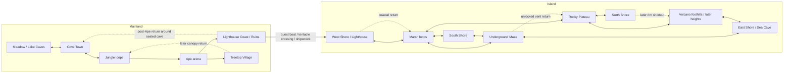

# Be the Knight: story world, chapter 1

Original design notes from 2026-10-24, with the map plan updated 2026-11-07.
Some systems and rooms already exist; `TODO.md` and `docs/NONMAP_SYSTEMS.md` track delivery.
The current map plan below supersedes conflicting older route/reward descriptions; it is a plan, not a claim that these layouts are built.

## Identity and framing

The protagonist is **Be**, a woman whose opponents mostly represent entities within
her. Levels connect inner experiences to the real world: a jungle can evoke a
city jungle, for example. These are references to develop, not fixed diagnoses or
an instruction to turn every enemy into a literal real-world person.

The new Kraken encounter and stat progression are recorded in
[Be the Knight design](BE_THE_KNIGHT_DESIGN.md). Existing room IDs and routes stay
stable until their narrative names and connections are deliberately authored.

Be faces right from the start, and the route mostly moves right.

## 0. Current map plan: room clusters and branching connections

Updated 2026-11-07 from the user's direction. Plan the world as **large, dense chunks of rooms**, separated by variable distances and joined by long playable routes. Leave occasional holes inside the chunks for secret rooms. Connections should branch, offer optional discoveries and reconnect through extra paths and shortcuts. The world should feel geographically huge while becoming quick to cross once explored.

### 0.1 Spatial rules

- A chunk is a recognizable local network, not one oversized room. Aim for roughly 4–7 main rooms per substantial chunk, with smaller 2–3-room satellite areas where appropriate. These are planning targets, not a room-count quota. Each named explorable area has at least two rooms; a boss arena is the explicit exception and remains **one tall room** within its surrounding area.
- Pack rooms horizontally and vertically into irregular silhouettes: shelves, staggered stacks, overlapping levels and recessed bays. Avoid a uniform rectangle or a single line of rooms. Preserve existing useful rooms and IDs where practical.
- Separate chunks by actual playable geography: coastal tracks, ravines, root tunnels, ridges and aqueduct-like passages. Vary the distances. Space on the overview must correspond to a credible route; do not stretch the diagram without giving the player a place to traverse.
- Reserve one or two irregular pockets in most large chunks. Some become secret rooms; leave some as natural empty space so every hole is not an automatic reward marker. Draw reserved pockets in the planning diagram, but keep undiscovered rooms concealed in the player's map.
- Keep most ordinary rooms low and compact, initially using the existing 13–18-tile heights as a starting band. Diversify widths, floor profiles, entrances and occasional medium-height rooms. Reserve major vertical scale for lighthouse climbs, a few shafts, volcano vistas and boss arenas. Confirm every dimension with actual movement/camera metrics before committing geometry.

### 0.2 Connectivity and travel

Use two layers of connections: **local loops inside chunks** and **regional loops between chunks**.

- Most chunks should eventually have at least two independent entrances/exits on different sides or heights. An introduction, isolated reward chamber or boss approach can be a deliberate exception. Count the room connections and gates, not just lines that look close on the overview.
- A major connector should usually offer a meaningful fork: a safer lower route versus a harder upper route, an NPC/reward detour, or a route opened by a later ability. Most side branches should rejoin the connector or enter another chunk. Keep a few short, rewarding dead ends for contrast.
- Give a long connector several beats: departure landmark → traversal challenge → fork/discovery → breather → arrival landmark. Split it into multiple low rooms if needed. Avoid repeating the same jump or making long stretches of empty walking.
- Plan a local return loop for every substantial exploration branch and a regional shortcut for each major inter-chunk trip. Shortcuts might be a sword-opened passage, a gate opened from its far side, a short lift/shaft, or a bridge. Use existing mechanics first; list any new mechanic as a dependency before relying on it.
- Reveal shortcut destinations before opening them where possible: a familiar skyline, a closed gate visible from the hub, or an overlook above an earlier room. Opening one should make the player recognize where they are.
- Keep first discovery long enough to establish distance, but make known return routes much shorter. **Initial playtest targets**, excluding exploration/combat pauses: roughly 45–90 seconds for a substantial connector on first traversal; its opened shortcut should take at most half that time, preferably 15–30 seconds. Revisit these targets after blockout rather than padding rooms to meet them.
- A regional shortcut should skip repeated traversal, not silently bypass the next quest, mandatory encounter or unearned movement gate. Check reachability separately before and after each progression milestone.

### 0.3 First landmass: proposed chunks and loops

| Chunk | Existing anchors / intended contents | Additional paths and shortcuts |
| --- | --- | --- |
| Meadow and Lake Caves | Meadow, big-jump overlook, lake/cave network; compact upper/lower room stacks | Loop the cave branches back toward the lake. Keep the wavedash gap visibly reserved for later; reaching Cove Town must not depend on crossing it. Reserve a secret pocket between upper meadow and lower cave rooms. |
| Cove Town | Town and enterable houses; clear calm meeting point between cave and jungle routes | Main jungle approach plus a lower drainage/root route that reconnects later. A return opening should land near a recognizable town landmark. |
| Jungle and Ape approach | Existing jungle rooms around waterfall/root routes; quiet approach before the single tall Ape arena | Upper canopy and lower roots form a loop **before** the arena. Post-Ape exits remain gated until victory; no optional passage should bypass the fight. Add a later route back around any permanently sealed chase section. |
| Treetop Village | Expand the village into at least two rooms, with a safe village floor and a traversal annex | First approach from the jungle branch; later canopy descent reconnects to an earlier jungle junction. Wall-climb reward placement remains a progression decision, not a prerequisite for entering the village. |
| Lighthouse Coast | Beach, lighthouse stairs/top, NPC sword quest and a small 2–3-room ruins area below | A beach/ruins/lighthouse-base loop makes the quest return short. Add a post-Ape landward return path toward the jungle/town that avoids the sealed chase cave. Keep the tower's initial ascent meaningful; open a faster descent/return once visited. |

The three required quest crystals belong behind clearly readable sword-breakable barriers on the ruins' normal exploration branches. They must not require finding an unmarked secret pocket or a later movement ability. Give the final crystal branch a short return connection near the lighthouse approach. Remove the earlier sand-cave sword reward during this map pass.

Western Wilds and Landing already form an additional branch: preserve them as a separate optional cluster, with their internal loop and a clear return to the mainland network. Do not accidentally promote them into a new prerequisite for the lighthouse quest.

### 0.4 Volcanic island: proposed chunks and loops

Keep four geographically honest shores: **west, north, east and south**. North belongs toward the top of the overview and south toward the bottom. Adjacent land and landmarks should remain consistent at both ends of a connection.

| Chunk | Intended structure | Connections and optional content |
| --- | --- | --- |
| West Shore / arrival lighthouse | At least two compact rooms: washed-ashore beach and lighthouse/shelter area; sea on the left | Main route heads inland to the marsh. A coastal branch reconnects to the marsh's lower route. Show the lost boat through the arrival event; do not place a usable replacement boat here. |
| Marsh | Dense 4–7-room chunk with low, interwoven channels, dry islands and thick-water pockets | Upper dry route and lower wet route diverge/rejoin, with at least one cross-link. Secret pockets fit inside root/stone masses. Introduce thick water in a safe, shallow section; do not require a long submerged swim with starting stamina. |
| Rocky Plateau | Multi-room terraces and tall rock inhabitants whose feet interrupt horizontal runs | Main ground route plus a quieter shelf/tunnel alternative; connect to north-shore spur, volcano foothills and a marsh return shortcut. Giants are dodgeable obstacles for now: do not require climbing them. |
| Volcano | Large footprint built from several low/medium rooms and a few exceptional vertical chambers | Early cool foothills and a brief readable heat preview; deeper routes remain gated by later movement/heat planning. Create cross-connections between ascent, east slope and lower tunnels rather than one exhausting staircase. |
| Underground Maze | Existing junction, flooded hall, echo gallery, lower maze, vent shaft and refuge as a folded network | At least two surface access points, proposed at the marsh/plateau side and east sea-cave side. A cross-link and unlocked vent return provide alternatives to retracing the entire maze. The Guardian is one tall arena, approached from a calm room. |
| North, South and East Shore satellites | Each shore is an actual area with at least two rooms; vary coves, overlooks and access tunnels | North branches from plateau; south from lower marsh/maze; east from east slope/sea cave. Reconnect each satellite to a second island route where progression permits. Keep future sea-travel exits visible without inventing their destination maps yet. |

**Conceptual connection graph** — lines show intended routes, not current room adjacency; dashed lines are later shortcuts. Mainland and island subgraphs are separate physical landmasses.

Each bidirectional line is a target for the eventual explored network, not permission to ignore gates on the first visit. The coast/ruins quest must unlock departure; the first crossing must run the tentacle event and end with the boat lost. **No cave, bridge, shortcut or touching map seam may connect the two landmasses across the sea.** Cross-island loops remain land routes on the volcanic island; they do not restore mainland travel after the shipwreck. A future return voyage needs an explicit progression decision.

### 0.5 Secrets, rewards and pacing

- Put secret entrances in the structure: a suspicious wall beside a main route, a recessed underside, a gap behind a waterfall, or a later-reachable ceiling ledge. Hint at them through geometry, sound or a partial view; avoid arbitrary mandatory pixel searches.
- A secret pocket should have a purpose and a safe return. Larger optional spaces can connect two routes, making discovery itself a shortcut. Keep some purely optional reward rooms so not every secret is essential navigation.
- New discoveries are interactable energy fragments, stress-capacity upgrades, NPCs or optional encounters/minibosses. Three energy fragments grant one stamina-capacity upgrade. Do not add new passive stars. The three lighthouse quest crystals are a separate item type and objective.
- Alternate calm junctions, traversal, encounters and rewards. Avoid putting an unavoidable giant stomp, deep thick-water drain and heat exposure into one connector before teaching them separately.
- Place a safe regrouping point before long hostile connectors and major encounters. Do not assume map stations, new save-point behavior or other unimplemented systems exist.
- Heat cannot be solved by resting while still inside a hot room: it suppresses natural regeneration. Time the early heat preview with current stamina, provide a quick retreat to cool ground, and keep optional upgrades from becoming hidden survival requirements.

### 0.6 Authoring order and acceptance checks

1. Draw the chunk silhouettes, reserved secret pockets and long connectors on the world overview. Label every edge as first-visit, optional, ability-gated, post-encounter or shortcut. Account for the physical coastline and room bounds before moving rooms.
2. Record the player state at each milestone: jump-only start → Ape defeated → lighthouse sword/quest → three crystals returned → boat crossing/shipwreck → island exploration → explicitly chosen later abilities. List rewards and gates together so no ability is locked behind itself.
3. Block out one representative chunk plus its branching connector and shortcut. Measure ordinary jumps, camera framing, drain budgets and first/return travel times with current tuning before expanding the rest.
4. Build the mainland quest loop and preserve return access around sealed sections; then the island arrival/marsh/plateau loop; then maze/surface cross-links and shore satellites; finally later volcano routes and secret pockets. Keep boss arenas single tall rooms and all named areas at least two rooms.
5. Review the graph at each ability state, with one-way transitions represented honestly. Verify mandatory goals remain reachable, optional branches have an exit, and newly opened shortcuts materially reduce travel. Treat the shipwreck as a deliberate one-way chapter transition, not a missing return edge to “fix.”
6. Test physical seams/doors, room variants, checkpoints/spawn safety and actual encounter progression after moving/resizing rooms. Test movement reachability separately from the full event/quest run; a boss-free traversal test does not prove quest or shortcut gating works.
7. Walk the critical path without optional upgrades, then revisit every cluster using opened shortcuts. Check that the map feels broad through changing landmarks and route choices, while familiar destinations require little repeated traversal. Adjust distances and loops before adding final decoration.

This section authorizes planning only. Room files, placements, exact coordinates, later reward assignments and new mechanics are not changed by this document update.

## 1. Route

### 1.1 Start: flat meadow
- Mostly flat, a few jumps and a few spikes, nothing excessive.
- No enemies.

### 1.2 The big jump
- A gap meant for a **wavedash**, not a normal jump.
- Shape: a cone or triangle with the narrow point facing up.
- **Not crossable at the start:** the player has jump only, and a wavedash needs dash. It's a gate for later: the player returns once dash comes from a later level (which level is still open).

### 1.3 First lake and cave (below the jump)
- A lake at the bottom, darker than the meadow.
- A few tunnels that lead nowhere in particular.
- **Roaring sounds come from the left** (stereo, panned left; see Audio). They hint at the ape.

### 1.4 Cove or small city
- Further right: a cove or small town with a couple of NPCs.
- NPCs don't exist in the game yet (see Systems).
- **The second stamina block is collected here.**
- Has at least one quest that rewards a skill point (true for every village).

### 1.5 Jungle (right of the city)
- A waterfall, lots of vegetation, a lake; the player drops down again here.
- Big trees and tree trunks.
- Enemies that aren't aggressive: they just walk back and forth.
- Exploration: hills and tunnels, still heading right.
- In a couple of places, platforms made of leaves can be reached.
- New content: **leaf platforms**, a **forest** environment theme, **waterfall blocks**.

### 1.6 Boss 1: the Ape (end of the jungle)
See Bosses. Reward: a power-up.

### 1.7 The fork after the Ape
Past the Ape the path splits. Each side changes the story.

**Right: sand cave → shore**
- A cave full of sand and breakable platforms, climbing diagonally at about 30°, with some platforming.
- Entering triggers the Ape's scream; **the Ape chases the player**.
- Sounds: the arena fight opens with `ape_scream`; the cave chase uses `ape_scream_cave` (same cry, echoed). Both are synthesized in `scripts/sfx.gd`, 5 tones lower than the first draft.
- The chase replays one planned run (`ApeChase.plan` in `scripts/entities.gd`): the player's own movement code, off spikes and breakables, with the Ape's whole 24px contact box clear of the terrain. Breakable rock (low ceiling, hanging chunks): the player passes under it, the Ape smashes through (not saved, so it is back after a death).
- At a small gap the player hears the Ape hit the wall; rocks fall and seal the cave behind them. This starts the second part.
  Built: six breakable rocks (the low ceiling over the third pit and five hanging chunks) hurt the Ape as it smashes them (it blinks). The player only dies if the Ape gets past them: a tunnel-high line at its centre, so corners don't save you. Each landing shakes debris off the ceiling. The Ape itself triggers the end: reaching its last stretch (`end`), the ceiling caves in just ahead of it (`seal`), stopping it and sealing the way back for good.
- Reward on this path: **the sword** (see Stamina for its costs).
- The sealed cave can't be re-entered, so the only way is right, to the shore.
- The shore offers two options:
  1. **Left: a mountain.** Clearly climbable, but beyond the player's current abilities. Hints that it can be climbed later; nothing else for now (maybe some collectibles).
  2. **Right: a raft** ("zattera") to reach the next island to the right.
- **Lighthouse:** next to the raft stands a big, primitive stone lighthouse. On top burns a magic flame, aimed in a single direction by mirrors.
- **Silent village** at the top of the lighthouse: 4-5 NPCs who answer every interaction with "...". One NPC gives a quest; the raft can't be used until the player has spoken to them.

**Left: jungle again → Treetop Village**
- The Ape screams and the jungle has to be crossed again.
- The player is caught by people with spears: a net on the floor snares them (needs a capture animation), and they are taken up into the trees.
- **Treetop level:** platforming matters most here.
- It starts with a **treetop village** where the player can't fall down.
- Bridges between platforms: moving, oddly behaving bridges (needs a flexible bridge entity).
- Reward on this path: **wall grab** (holding onto a vertical wall).
- Still open: where the player goes after the village (TODO).

## 2. Bosses

Every boss is a gimmick boss, mostly based on platforming.

### The Ape
- Size: about 4 units. Comes back to life (reanimates).
- The player dodges parabolic throws (like the Skeleton's), slime on the ground, and the scream.

Attacks, chosen by distance to the player:

| Attack | Range | Detail |
|---|---|---|
| Stone throw | far | Big stone: 2.5-unit sprite, 2x2-unit hitbox. Parabolic arc. |
| Slam | mid | Jumps and slams the ground. Overshoots on purpose (below). |
| Scream | near | Reaches 3 units around the Ape. |

Arena and collision:
- The tree obstacle, fallen-trunk bridge, bridge pit and tree-bait tutorial are removed.
  The former pit is filled with solid ground. The Ape uses one leap range across
  the arena (`range: [72, 568]`); there is no tree-dependent `range2` stage.
- Lure the Ape's overshooting leaps onto spikes. Three spike hits beat it;
  subsequent hits introduce more spike patches. Gates and the stamina reward remain.
- Arena 31 tiles wide and empty (2026-10-25, user's World Editor edit: no ledges, platforms, starting spikes or
  walk-in; both doorways drop into it). Idle waits are 15% shorter; the landing shockwave is 60 px wide.
- Spikes come only from logs: every leap, the hops in place too, shakes one log loose at a random spot (never overlapping
  another); where it breaks on the ground it leaves a 1-tile spike. Landing on spikes hurts the Ape and breaks
  exactly those. No spikes are generated on hits.
- Attack choice: a stone throw on 20% of attacks at random; otherwise scream within 44 px, leap beyond. No scream
  when the player is cornered against a wall the scream reaches (it leaps instead). Waits x0.765.
- Enraged after 2 hits: stones split in two on the ground, and a scream is followed by 2 hops in place with
  shockwaves 130% then 170% as wide.
- Body contact uses 70% of the original width and height, rounded from 32 to
  **22×22 pixels**, centred inside the sprite's movement footprint. Three bands
  narrow the upper body around the head and shoulders; the head follows crouching.
  This is 70% per dimension, not 70% of area. Drawing and terrain movement retain
  the original 32×32 footprint, so boss placement and landing remain stable.
- The scream is an exact circle centred on the Ape, radius **40 pixels** (16px
  half-body + 24px reach). Collision uses the nearest point of the player's damage
  rectangle, so square corners are safe while an overlapping edge is still hit.
  Its 0.5s wind-up and 0.35s active window remain. Hitbox debug drawing uses the
  same body bands and circle; the scream animation stays inside its damage radius.

## 3. Stamina

(Dropped: boss fights no longer drain stamina.)

Stamina is also health:
- It replaces hearts. The icon is still undecided; it shows as **blocks**.
- **1 block = 100 stamina** in code. Every value below is in code units.
- In code now (`scripts/adventure.gd`): stamina starts with a **base of 32**; each stamina block adds **20**. All owned bars regenerate to full, including completely emptied ones. Regeneration is 2/s empty, rising to 6/s at half capacity and falling to 3/s full, scaled by stress; none in water, while climbing or during the blocking portion of a stun. A jump or wall jump costs and needs 5. Climbing drains the same bar; standing on ground does not instantly refill it. Water drains 40/s; 0 in water drowns. A hit causes respawn, which immediately restores at least the base bar. A stamina orb instantly refills to max. Hair turns grey below 20%.
- With 1 block the player can use one ability, then has to rest before using another.
- The 2nd block comes from the first city.

More stamina unlocks more abilities:

| Stamina | Unlocks |
|---|---|
| some | jump about 10% higher |
| more | attack |
| more again | the cool abilities (some need even more) |

The thresholds aren't set yet.

Costs:
- Sword: needs 2 blocks (200) to be used at all.
- Sword swing: 10 per swing.
- Sword hit: 15 more per enemy hit (25 for a swing that lands). Swing only when you mean it.
- Wall grab: 20-30 per second while holding on.
- Jump: 5 per jump, and a jump needs those 5: with less there's no jump (wall jumps and swim strokes stay free).
- Some abilities cost a whole block and have to be recovered before reuse.

Regeneration:
- 6 stamina per second (doubled from 3 on 2026-10-24).
- The base (the first 50) always refills, even from 0.
- Above it, only inside the current block: an extra block that is fully spent doesn't refill.

Water:
- Underwater is its own state, **Normal (Underwater)**, which replaces Normal in water: slow sinking, no walking on the floor (along it the player moves as mid-water), and no normal jump. **Jumping (Underwater)** is a weaker stroke (about half a jump's height) that works from the floor or mid-water, every time jump is pressed; with the surface close above, it leaps out of the water like a normal jump. Dash still works.
- Waterfalls are a layer on top of the current state: inside one the player is pulled down, so jumps rise much less.
- Staying in water costs 2.08 stamina every 0.1 s (20.8 per second), and stamina doesn't regenerate there.
- Running out of stamina in water is a death (drowning).

## 4. Skill points

- Every village has at least one quest that rewards a skill point.
- Skill points go into regeneration, damage, speed and other stats.
- Later, active abilities can be bought with them too.

## 5. Systems the story needs

- **NPCs:** scripts don't exist yet. Needed: dialogue, a talk button, the "..." reply, quest flags (the raft needs the quest NPC).
- **Interact button:** none exists yet.
- **Positional audio:** a stereo engine where sounds attach to sprites and pan by position (enemy on the right → heard on the right). Above and below are harder; research how other games fake height (HRTF or elevation cues) before building.
- **New content:** leaf platforms, forest environment theme, waterfall blocks, moving bridges, breakable sand platforms, net capture animation, raft, lighthouse.

## 6. Built so far

`worlds/story/` (Adventure menu → World: Story), 18 rooms, jump only:
Meadow → The Big Jump (fall into the gap) → Lake Cave → Cave Teeth → Cove Tunnel → Cove Town (stamina block on a roof).
Lake Cave has neighbours of its own: Roar Tunnel on the left (dead end, the roar), and Deep Lake below. A hole in the lake floor drops into Deep Lake (flooded, a star in the corner), and a shaft of jump-through platforms climbs back up into Lake Cave.
Right of Cove Town the jungle (forest theme) runs Jungle Edge → (drop) → Jungle Falls → Jungle Hills, with leaf platforms, a waterfall over a lake, hollow trunks, tunnel hills and calm Mosstrots. A star sits at the top of each leaf climb.
Past the jungle: the Ape Arena, with the fight built (see section 2: open arena, four spike hits, gated exits), then the fork. Right: Sand Cave (a climb at about 25°, crumble blocks for breakable sand) → Shore (the mountain's foot, the sea, the lighthouse) → (its door) Lighthouse Stairs → Lighthouse Top (the silent village). Left: a hole in Jungle Hills' floor → Jungle Depths; roots cover it until the Ape is beaten. Leaving the arena on the left (floor-level opening), the Ape follows you leftward through Jungle Hills until the big trunk's low hollow stops it, just short of the hole (`ape_chase` with `dir: -1`, `after`) → Net Trap (a door stands in for the net lift) → Treetop Village above the arena.
Roar Tunnel plays a one-shot stereo roar from the left, with cave reflections. NPCs, quests, the chase, the rock fall, the raft and the rewards (sword, wall grab) are notes in the rooms for now.
`tools/story/gen_first_stretch.py` generates these rooms, but only the rooms you name (`... worlds/story a1_ape_arena`, or `all`), since rooms are also edited in-game.
`tests/test_runner.gd` runs a jump-only bot from the meadow to the end of the jungle.

## 7. Decisions

- 2026-10-24: the story world starts with **jump only**. Dash, climb and attack are adventure abilities unlocked by orbs (`Game.has_ability`).
- 2026-10-24: the big jump gets nothing for now. It stays uncrossable until dash comes from a later level.
- 2026-10-24: water drains stamina (0.05 every 0.1 s, no regeneration in water); out of stamina in water = death.
- 2026-10-24: water drain raised 10x, to 0.5 every 0.1 s (5 per second).
- 2026-10-24: water drain doubled to 1 every 0.1 s (10 per second); the waterfall pull is softer (jumps rise, less).
- 2026-10-24: water drain doubled again, to 2 every 0.1 s (20 per second).
- 2026-10-24: water drain set to 80% of that: 1.6 every 0.1 s (16 per second). No stamina, no jump. Jump cost lowered to 5.
- 2026-10-24: water drain raised 30%, to 2.08 every 0.1 s (20.8 per second).
- 2026-10-24: an stamina block adds 75 (was 100); a hit still costs 100.
- 2026-10-24: waterfall blocks (my reading of the brief): falling water the player can walk through but not jump up; it pushes them down.
- 2026-10-24 (superseded by tree removal below): Ape arena reworked: you meet the Ape first, on your side of the pit. Get past it, stand past the tree, and its stone or leap fells the tree across the pit; it follows you over for the spike phase.
- 2026-10-24 (tree setup superseded below): Ape fight built. Walking past the trunk wakes it; standing behind the trunk baits the stone that fells it. Stones are 2x2 units with the sprite the same size as the hitbox. Exits are sealed until it's beaten; afterwards stamina drops to 5 and an stamina orb appears. The power-up reward is still open.
- 2026-10-24: the run starts with a base of 50 stamina that always regenerates; stamina blocks add 100 each. A jump needs its 5.
- 2026-10-24: Ape arena 70% as wide (56 tiles); entering, the player is walked off the ledge into it and the entrance shuts until the Ape is beaten. Sand Cave, Shore and Lighthouse Top moved 24 tiles left to stay attached.
- 2026-10-24: the lighthouse reworked: a solid tower on the shore with a house door at its foot, an inside room (Lighthouse Stairs, two screens of zigzag platforms) and a door at the top onto the gallery where the silent village is.
- 2026-10-24: Cove Town's houses open: house doors (stand at one, press up) lead to the Villager's House and the Quest Giver's House, where the NPCs will live (notes for now).
- 2026-10-24: the death counter counts every respawn, including hits that only cost a spare block.
- 2026-10-24: stamina built first. A hit with a block to spare costs the block and respawns the player at the room's spawn, like Hollow Knight's hazard respawn; the last block is a death and refills stamina.

- 2026-10-24: the Ape's contact hitbox is one rectangle, 24x24 centred (a bit larger than the head-contour bands it replaced).
- 2026-10-24: Removed the arena tree puzzle and bridge pit, unified the leap range, reduced body-contact bounds to 22×22 with a head contour, and made scream collision circular (40px radius).

## 7b. The eastern island (built 2026-10-25, blockout)

Design: `docs/reviews/eastern-island/`. Generator: `tools/story/gen_island.py` (17 rooms, mostly about one screen).
- The raft is a house door on the Shore's beach (interact); the lighthouse quest gate isn't built yet.
- Shores: West (arrival), North (up a ladder; a star on a cliff), South (down through a crust; a star), East.
- Volcano: Foothills, Volcano Ascent (narrow, two screens tall), Crater (lava pools), East Slope down to the East Shore.
- Under the volcano: Sea Cave, Junction, Flooded Hall (deep water crossed on stone pillars while rocks fall from the
  ceiling: `rockfall`), Echo Gallery, Lower Maze, Vent Shaft, Quiet Refuge (stamina orb), Guardian Chamber (40x46).
  Optional: Crystal Pocket (a star).
- Jump only. Vertical links are shafts of jump-throughs 3 rows apart; a crust (jump-through flush with a floor)
  drops through with down + jump. `tests/test_island.py`: every room and star reachable, far rooms lead back.
- The Guardian (`boss_guardian`): marks the ground under the player, then erupts there (24x32 px). Bait three
  eruptions onto the vent plugs (floor, middle ledge, high ledge); the warning shortens 1.0 / 0.85 / 0.7 s.
  Beaten: saved, the gate opens, a door home appears; chamber and west shore swap to "after" variants with a
  door pair (the shortcut). No reward yet.

## 8. Open questions

1. Which later level gives dash, so the big jump (section 1.2) can be crossed.
2. Stamina thresholds for each unlock (+10% jump, attack, abilities).
3. Stamina icon to use instead of hearts.
4. Where the Treetop Village leads.
5. How the two branches meet again, if they do.
6. Wall grab costs 20 or 30 per second?
7. How much stamina collectibles restore (the stamina orb refills everything for now).

