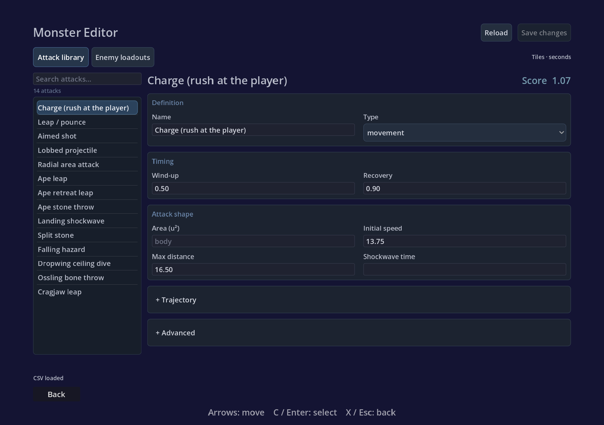
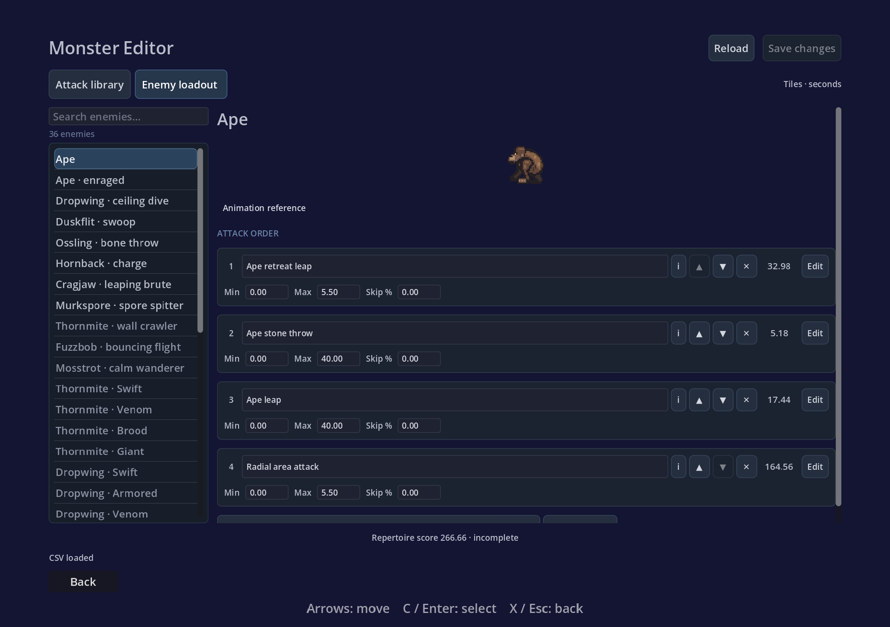

# Attack catalogue integration — 2026-10-31

Desktop Monsters opens the CSV catalogue for attack/range editing and reference
score inspection. Source edits are private until Save and validated before the
shared runtime catalogue is refreshed. Existing bestiary information is retained.

Validation covers CSV round trips, invalid input, score examples, weighted volleys,
range order/fallback, Ape phases, form save, and active-attack snapshots. Full
physics and smoke scenes exercise existing gameplay. The web export includes CSV
data and excludes the development editor.

See [the guide](../../docs/ATTACK_CATALOG.md) for current limits: reference-only
ballistic measurements, unscored slow attacks/falling logs, and composite boss
scoring still to be defined.

## Layout revision — 2026-11-01

Searchable navigation, distinct Attack library / Enemy loadouts tabs, grouped
setting cards, and collapsible trajectory/advanced controls. Enemy cards keep
range/priority controls visible and open detailed mechanics with Edit. The score
uses hover details; Save and Reload remain in the page header.

Verified search-to-row mapping, empty results, preserved enemy view after saving,
and existing catalogue editing workflows. Screenshots show the revised layout.
