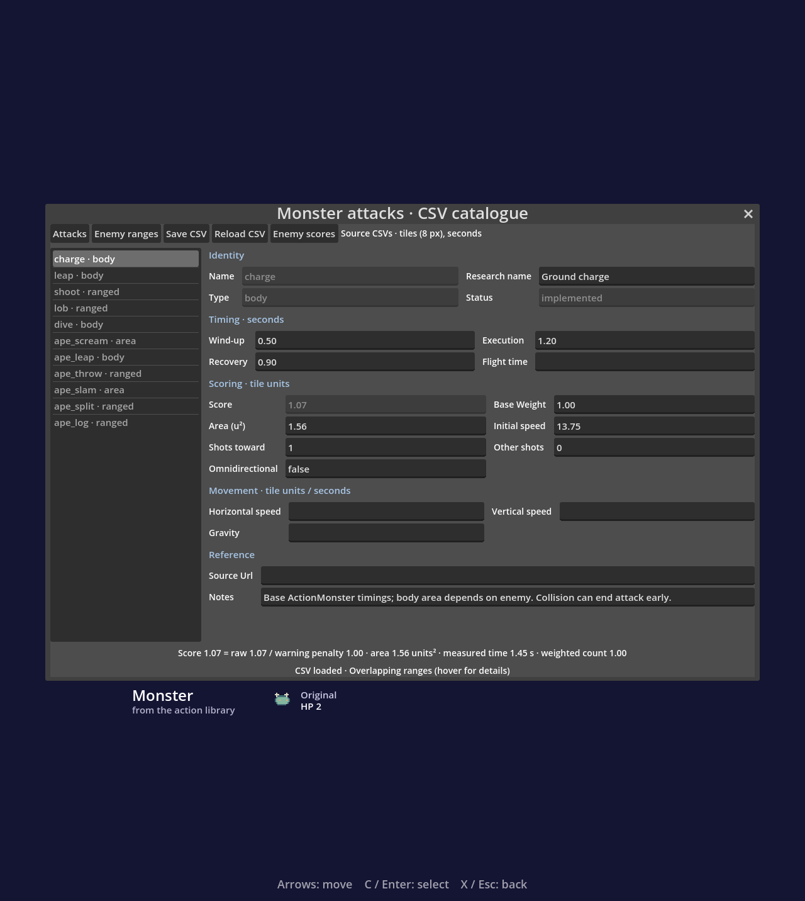
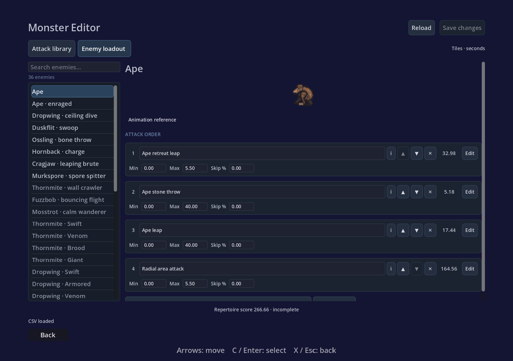

# Combat And Editor: consolidated historical records

Merged 2026-11-07. These are dated records, **not a current task list or instructions to rerun old fix prompts**.
Current status: [implementation ledger](../../docs/IMPLEMENTATION_STATUS.md). Current tasks: [TODO](../../TODO.md).
Later delivery records can supersede earlier findings. Recorded test results describe their original run; this cleanup did not rerun gameplay.
Screenshots, logs, code probes and data remain in their original evidence directories. Original Markdown paths are compatibility redirects.

## Contents

- [reports/ape-attack-triggers-2026-11-06/README.md](#reports-ape-attack-triggers-2026-11-06-readme)
- [reports/ape-composition-2026-11-03/README.md](#reports-ape-composition-2026-11-03-readme)
- [reports/ape-followups-2026-11-04/README.md](#reports-ape-followups-2026-11-04-readme)
- [reports/ape-recursive-review-2026-11-03/README.md](#reports-ape-recursive-review-2026-11-03-readme)
- [reports/ape-return-barrier/README.md](#reports-ape-return-barrier-readme)
- [reports/ape-unified-editor/README.md](#reports-ape-unified-editor-readme)
- [reports/attack-catalog/README.md](#reports-attack-catalog-readme)
- [reports/compact-attack-fields-2026-11-06/README.md](#reports-compact-attack-fields-2026-11-06-readme)
- [reports/cornered-coverage-2026-11-06/README.md](#reports-cornered-coverage-2026-11-06-readme)
- [reports/monster-editor-review-2026-11-01/README.md](#reports-monster-editor-review-2026-11-01-readme)
- [reports/nonmap-systems-2026-11-07/README.md](#reports-nonmap-systems-2026-11-07-readme)
- [reports/partial-foundations-2026-11-05/README.md](#reports-partial-foundations-2026-11-05-readme)
- [reports/patrol-authoring-2026-11-05/README.md](#reports-patrol-authoring-2026-11-05-readme)
- [reports/punch-2026-11-05/README.md](#reports-punch-2026-11-05-readme)
- [reports/stress-2026-11-05/README.md](#reports-stress-2026-11-05-readme)

---

<a id="reports-ape-attack-triggers-2026-11-06-readme"></a>

## Source: reports/ape-attack-triggers-2026-11-06/README.md

Original source: `reports/ape-attack-triggers-2026-11-06/README.md`. [Evidence directory](../ape-attack-triggers-2026-11-06/).

# Configurable Ape attack conditions

Each normal/enraged binding row now has a Trigger selector. Retreat leap exposes its previous hidden cornered-player rule; conditions can be independently changed per phase and saved in the catalogue CSV. The selector also offers normal rules, vertical alignment, nearby/far and always. Explicit conditions replace per-attack heuristics while preserving selection priority, maximum range, skip chance/cooldown and attack execution timing.

This does not turn selection reactions into world-editor trigger zones or landing effects. A condition makes the attack eligible on the next idle decision. Legacy catalogues retain their old behavior through the default migration.

Verification: new `tests/ape_attack_triggers.tscn` covers the real Ape decision path, cornered/vertical/always changes, range and skip policy, unknown-condition rejection, picker visibility, per-phase save/reload and old-CSV migration; 0 failures. Gameplay runner: 0 failures. Catalogue: ATTACK CATALOG OK. Ape follow-ups: 0 failures. Smoke: SMOKE OK. GDScript lint and diff whitespace checks pass. Catalogue/follow-up shutdown resource warnings remain.

`capture.tscn` renders the production editor; `editor.png` shows the retreat's per-phase triggers.

The later [coverage-based corner definition](../cornered-coverage-2026-11-06/README.md) supersedes the original horizontal wall probe described in this first trigger slice.


---

<a id="reports-ape-composition-2026-11-03-readme"></a>

## Source: reports/ape-composition-2026-11-03/README.md

Original source: `reports/ape-composition-2026-11-03/README.md`. [Evidence directory](../ape-composition-2026-11-03/).

# Ape composition: first implementation slice

The Enemy tab now edits health, phase-two threshold, and the phase-entry wave-scale
sequence. Trigger-only effects appear after selected attacks and bypass AI
eligibility/chance checks. Falling/thrown logs share projectile collision and floor
impact; phase-two parents split at the apex into two ordinary logs. Each valid
child floor impact makes a spike. Collision with another object can end a log
before floor impact.

Transient effects are cancelled on the lethal hit. Ground waves are anchored at
the landing point. A regression also covers the old infinite corner-search loop
when the player is exactly vertically aligned with the Ape.

Authoring: `data/attacks.csv`, `data/enemy_attacks.csv`, and
`data/enemy_profiles.json`. The existing Save stages the full content set and
includes profiles in external-edit checks. This extends its synchronous rollback;
it does not implement the future crash-recovery manifest described in the plan.

## Verification

All four scenes exited 0 after the final gameplay/editor changes:

```sh
godot --headless --path . res://tests/test.tscn
godot --headless --path . res://tests/smoke.tscn
godot --headless --path . res://tests/attack_catalog.tscn
godot --headless --path . res://tests/ape_composition.tscn
```

Physics: 0 failures. Smoke: SMOKE OK. Catalogue: ATTACK CATALOG OK.
Ape composition: 0 failures. The smoke scene still emits its pre-existing
`ApeChase: no path found to x 496` warning for its synthetic fixture, also observed
before these changes. No new runtime/script errors appeared in these runs.

The editor import completed successfully using disposable settings. Rendered
captures were inspected: [health/phase controls](../ape-composition-2026-11-03/editor.png),
[attack controls](../ape-composition-2026-11-03/attacks.png), [triggered effects](../ape-composition-2026-11-03/effects.png), and
[arena/log appearance](../ape-composition-2026-11-03/arena.png). `capture.tscn` reproduces these fixtures without
saving an adventure or modifying a room.

Tests were first observed failing for missing authored health/trigger bindings,
then for rounded profile persistence, death cleanup, shared dimensions, anchored
waves, and pending scores. The vertical-alignment regression timed out before the
wall-search guard and completed afterward.

## Remaining scope

This is the first Ape slice of the [mechanics plan](../../docs/MECHANICS_ARCHITECTURE_PLAN.md).
General event-graph authoring/attack runners, traps, patrol authoring, inventory,
player-state extraction, hidden-terrain mechanics, and the level pass remain
planned. Encounter decision/choreography code still lives in `entities.gd` while
projectile and area mechanics have moved to `scripts/effects/attack_effects.gd`.
Consequence-chain scoring and final encounter tuning remain separate decisions.


---

<a id="reports-ape-followups-2026-11-04-readme"></a>

## Source: reports/ape-followups-2026-11-04/README.md

Original source: `reports/ape-followups-2026-11-04/README.md`. [Evidence directory](../ape-followups-2026-11-04/).

# Ape follow-up implementation

Scope: the five tasks in `docs/reviews/ape-composition/CODEX_PROMPT.md`.

1. **Effect listing:** derives phase-specific effects from the runtime profile;
   shipped CSV bindings contain selection rows only. Legacy triggered rows remain
   readable and are migrated out on save. Four initial UI assertions failed before
   the fix; migration had its own observed failing assertion. Follow-up, catalogue,
   and composition scenes pass. Full verification: `task1-verify.txt` (`0 failing`).
   Both phase pages were rendered and inspected: `normal.png`, `enraged.png`.

2. **Configurable test fixtures:** physics checks use a controlled five-HP profile
   and compare damage against the actor's starting health. Composition assertions
   isolate phase/hop settings and restore the original runtime profile afterward.
   Before the fix, valid changed HP and changed hop-count cases each failed one
   assertion. Both now pass. The main verification script includes composition,
   varied-profile, and follow-up scenes: `task2-verify.txt` (`0 failing`).

3. **Effect tooltips:** card and section help comes from the same profile graph,
   including current source names and events. Six assertions covered graph edits,
   phase-specific projectiles, source renaming, and live help refresh; all pass
   after observed failures. Catalogue/follow-up checks and gdlint pass. Actual
   wrapped hover help was inspected in `normal-tooltip.png` and `enraged-tooltip.png`.

4. **Blocked split children:** validate each proposed child position against real
   terrain and the effect lifetime bounds. A blocked child emits one cancellation
   event; the Ape consumes it as a visible burst, without a floor spike. Fully
   free, one-sided blocked, and fully blocked cases pass, along with actual burst
   feedback. Seven initial assertions failed before the fix. Composition, physics,
   smoke, and gdlint checks pass; `split-blocked.png` records a disposable game fixture.

5. **First-save rollback:** records prior existence and successful replacements,
   restores existing files exactly, removes newly created finals, and cleans staged
   temporary files on failure. Stale backups are preserved without being mistaken
   for prior live files; recovery failures cannot be labelled successful rollback.
   Nine failure assertions were observed before the fix. Fresh/existing/stale-backup
   failure cases, later-stage failure cleanup, and successful first saves now pass.

All five tasks are complete in separate commits. Final `sh tools/verify.sh` output
is recorded in `final-verify.txt`: **0 failing**, including all follow-up regression
scenes, physics, smoke, the catalogue, Python tests, gdlint, and pyflakes. The suite
reports shutdown resource warnings in the discoveries and follow-up fixtures;
verbose follow-up inspection identifies audio stream/playback resources, with no
runtime/script errors. The blocked-spawn and both phase hover captures were inspected.

No authored room files are modified. This completes this five-task prompt; other
items in the broader recursive audit remain tracked there. Catalogue crash recovery
on load is separate from the synchronous failed-save rollback fixed here.


---

<a id="reports-ape-recursive-review-2026-11-03-readme"></a>

## Source: reports/ape-recursive-review-2026-11-03/README.md

Original source: `reports/ape-recursive-review-2026-11-03/README.md`. [Evidence directory](../ape-recursive-review-2026-11-03/).

# Recursive Ape audit evidence

See [the review](../../docs/reviews/ape-recursive/REVIEW.md) and
[fix prompt](../../docs/reviews/ape-recursive/CODEX_PROMPT.md). The original
[Ape follow-up prompt](../../docs/reviews/ape-composition/CODEX_PROMPT.md) was
cross-checked and corrected during this audit.

`*.json` files contain observed behavior, not assertions that the behavior is
correct. `zero_wave.log` and `invalid_health_ui.log` intentionally contain the
reproduced engine errors; `configured_health_tests.log` contains the test failure
under valid modified HP. `capture.log` includes the intentional invalid-draft
failure and its shutdown resource leaks. Keep those separate from the ordinary
passing checks in `verification.txt`.

Reproduce a probe from the repository root with disposable user data:

```sh
SUMMIT_REVIEW_CASE=retreat_gravity XDG_DATA_HOME=/tmp/summit-audit-replay godot --headless --path . res://reports/ape-recursive-review-2026-11-03/probes.tscn
```

Other cases are the JSON filenames without their suffix. Probe definitions are
in `probes.gd`; they mutate catalogue copies or process-local state, never the
authored room/catalogue files. Save-failure cases write only under `user://`.
Re-running probes refreshes their evidence JSON files; preserve the historical
observations when converting these into permanent regression tests.

`capture.tscn` opens the actual Monster Editor, captures the normal/enraged pages,
and reproduces blank-Health navigation using its real private draft. It never
invokes Save. The final screenshot shows the missing health input, not a mock UI.

Performance figures are local headless/debug observations. `ui_validation_cost`
warms the page and permits a process frame between each sample, recording
catalogue-validation calls/time separately. `projectile_cost` measures ordinary
updates; `outside_sweep_cost` deliberately measures an extreme accepted setting
and an already-expired/outside object. They do not establish mobile GPU or FPS
performance. `ui_cost` is an exploratory repeated-build sample; use the framed,
warmed measurement for the review's UI figures.


---

<a id="reports-ape-return-barrier-readme"></a>

## Source: reports/ape-return-barrier/README.md

Original source: `reports/ape-return-barrier/README.md`. [Evidence directory](../ape-return-barrier/).

# Post-Ape return barrier

Jungle Hills has a thorn barrier at (368,8), 8×112 pixels. It is open before
`a1_ape_arena:ape_144_120` is set and solid afterwards. The full-height barrier
separates the early Jungle approach from the Depths shaft, preserving both
onward routes: Jungle Depths/Treetop Village and Sand Cave.

- `before.png` / `after.png`: production-game captures.
- `tests/ape_return_barrier.tscn`: real collision, exit and room-reload checks.
- `tests/test_ape_return.py`: return blocked even with dash, climb and attack;
  forward routes remain reachable with the intended movement model.
- Progression report regenerated with post-boss barriers and arena continuation;
  browser checks confirm the Ape no longer offers early Jungle as a destination.

Gameplay runner: 0 failures. Smoke runner: SMOKE OK.


---

<a id="reports-ape-unified-editor-readme"></a>

## Source: reports/ape-unified-editor/README.md

Original source: `reports/ape-unified-editor/README.md`. [Evidence directory](../ape-unified-editor/).

# Unified Ape loadout

Both phases share one Enemy loadout page. Attack mechanics appear once; redundant phase boxes on the right were removed. The editor opens on Enemy loadouts. Numeric inputs and card spacing are compact, with existing names preserved. Binding rows keep phase-specific priority, range and skip chance. New bindings can target either phase or both.

Visual checks: attacks.png, compact-details.png and effects.png, captured with capture.tscn.

Verification: catalogue, phase listing/binding regressions, live effect tooltip regressions, smoke and GDScript lint. Full gameplay runner has one failure in the story bot's Jungle Falls traversal; the two jungle room files had existing local modifications and were left untouched. Catalogue test also reports renderer resource leaks on shutdown.


---

<a id="reports-attack-catalog-readme"></a>

## Source: reports/attack-catalog/README.md

Original source: `reports/attack-catalog/README.md`. [Evidence directory](../attack-catalog/).

# Attack catalogue integration — 2026-10-31

Desktop Monsters opens the CSV catalogue for attack/range editing and reference
score inspection. Source edits are private until Save and validated before the
shared runtime catalogue is refreshed. Existing bestiary information is retained.

Validation covers CSV round trips, invalid input, score examples, weighted volleys,
range order/fallback, Ape phases, form save, and active-attack snapshots. Full
physics and smoke scenes exercise existing gameplay. The web export includes CSV
data and excludes the development editor.




See [the guide](../../docs/ATTACK_CATALOG.md) for current limits: reference-only
ballistic measurements, unscored slow attacks/falling logs, and composite boss
scoring still to be defined.

## Layout revision — 2026-11-01

Searchable navigation, distinct Attack library / Enemy loadouts tabs, grouped
setting cards, and collapsible trajectory/advanced controls. Enemy cards keep
range/priority controls visible and open detailed mechanics with Edit. The score
uses hover details; Save and Reload remain in the page header.

Verified search-to-row mapping, empty results, preserved enemy view after saving,
and existing catalogue editing workflows. Screenshots show the revised layout.


---

<a id="reports-compact-attack-fields-2026-11-06-readme"></a>

## Source: reports/compact-attack-fields-2026-11-06/README.md

Original source: `reports/compact-attack-fields-2026-11-06/README.md`. [Evidence directory](../compact-attack-fields-2026-11-06/).

# Compact attack mechanics and one Range field

Mechanics cards now use natural widths with wrapping rather than equal-width grid columns. Cards no longer stretch to their neighbor's height; odd field counts no longer insert expanding filler controls. Reduced padding and shorter Horizontal/Vertical labels keep tooltips and inputs intact.

At a 900 px fixture width (852 px available), the leap's Timing / Damage & speed / Trajectory section drops from 194 px to 90 px high. At narrow widths cards wrap without losing fields. `before-900.png`, `after-900.png`, and `after-600.png` document those layouts. `editor.png` shows the actual Monster Editor.

Enemy bindings now expose **Range** and **Skip %**. Range is maximum center-to-center distance in tiles; 0 means any range. Editing Range also clears any imported minimum so it cannot silently constrain the displayed rule. Shipped minimums were already all zero. Existing CSV columns and the runtime's exclusive maximum convention remain compatible.

Verification: `tests/attack_catalog.tscn` → ATTACK CATALOG OK; `tests/ape_followups.tscn` → 0 failures; `tests/smoke.tscn` → SMOKE OK; GDScript lint and `git diff --check` pass. The catalogue runner still emits its existing shutdown resource-leak warnings. The new range assertions first failed with a legacy minimum of 100, then passed after the single-field normalization.

Render fixtures: `CAPTURE_PHASE=after godot --path . --rendering-method gl_compatibility res://reports/compact-attack-fields-2026-11-06/capture.tscn`; `page.tscn` captures the real page. No catalogue data is saved by these fixtures.


---

<a id="reports-cornered-coverage-2026-11-06-readme"></a>

## Source: reports/cornered-coverage-2026-11-06/README.md

Original source: `reports/cornered-coverage-2026-11-06/README.md`. [Evidence directory](../cornered-coverage-2026-11-06/).

# Coverage-based Player cornered

Implemented the approved logic in a reusable collision-query helper. The player must be grounded, supported within one tile of the enemy floor, fully between the enemy body and the nearest wall, and every available standing position in that corridor must be hit by the reference attack. Any solid in the first three rows above the floor qualifies as a wall; one-way platforms support floors but are not walls. Gaps and uncovered standing positions reject the condition.

The player-centred candidate tracer is the attack bounds plus two tiles total. It never enlarges damage coverage. Real hit callbacks avoid rectangle-versus-circle corner errors and can represent disjoint coverage; the helper does not infer an attack shape from area alone.

A separate enemy profile/editor setting chooses the coverage attack. The Ape supplies its actual circular scream footprint; retreat leap remains the independently configured reaction in both phases. Unsupported moving attacks are not offered as if they had complete static coverage. The shared helper is reusable, but other enemies still require an accurate footprint/context adapter.

Tests: `cornered_coverage.tscn` covers grounded/airborne and floor-height rules, low/third/fourth-row wall detection, ordering, gaps, circular corners, insufficient real reach despite tracer inclusion, coverage holes, mirrored sides, rectangular adapters and actual Ape retreat execution. It also checks that changing the real scream area affects detection. `ape_attack_triggers.tscn` covers separate coverage UI/save persistence. Both report 0 failures.

Gameplay: 0 failures after updating the old direct-decision fixtures to mark their standing players as grounded. Ape composition: 0 failures. Catalogue: ATTACK CATALOG OK. Smoke: SMOKE OK. GDScript lint and whitespace checks pass. The existing catalogue/composition shutdown resource warnings remain.

`capture.tscn` renders the production settings and reaction rows in `editor.png`. Source story room edits were preserved.


---

<a id="reports-monster-editor-review-2026-11-01-readme"></a>

## Source: reports/monster-editor-review-2026-11-01/README.md

Original source: `reports/monster-editor-review-2026-11-01/README.md`. [Evidence directory](../monster-editor-review-2026-11-01/).

# Monster Editor review — 2026-11-01

**Status: findings 1-12 fixed** (same day; re-running `probes.tscn` shows every defect key flipped, and
`tests/attack_catalog.gd` `_review_fixes` / `tests/test_runner.gd` cover them). Follow-ups: only the Ape retreat's
stone throw runs; other choices are labelled "not in game yet" rather than executed. The workflow, performance and
code-organization suggestions below are still open.

Reviewed commit `2f64b3a`, covering the editor, CSV model, menu exit paths, and the
runtime consumers in `entities.gd`. Production code and source CSVs were not changed.
The existing catalogue suite passes, but the targeted probes reproduce defects it
currently misses. See [observations.json](../monster-editor-review-2026-11-01/observations.json) for the raw evidence
and [probes.gd](../monster-editor-review-2026-11-01/probes.gd) for the disposable-data reproducer.

## Highest-priority findings

### 1. P1 — Renaming can redirect unrelated enemies to a planned attack

Location: `scripts/attack_catalog_editor.gd:344–350`.

Every keystroke in an ID field immediately rewrites all matching binding and
follow-up references. Create a planned attack, change its ID to `shoot`, then
continue to `shoot_variant`. The intermediate duplicate ID is invalid, but its
reference rewrites are retained. Both original bindings to the implemented
`shoot` are now redirected to the new planned attack. The final catalogue
validates, so Save can persist the corruption. A normal user typing a name with
an existing ID as its prefix can encounter this.

Fix: edit IDs as local text, then commit a unique validated rename atomically on
confirmation/focus commit. Use immutable internal IDs for references if display
names need frequent editing. Test intermediate collisions and cancelled renames.

### 2. P1 — Escape silently discards the draft

Location: `scripts/menu.gd:124–126`, compared with the guarded Back action at
`menu.gd:91–99`.

Edit a field, then deliver `ui_cancel` while no text control consumes it. The menu
immediately calls `_main()`, detaches the editor, and creates no confirmation.
Back does ask. Probe: dirty editor removed, confirmation count **0**.

Fix: route Back, Escape, and page-close requests through one guarded exit method.
Offer Save / Discard / Cancel and test the actual unhandled-input path.

### 3. P1 — Runtime-used component IDs can be renamed or deleted

Locations: `attack_catalog_editor.gd:285–289`, `:319–320`, `:868–879`;
`attack_catalog.gd:7`, `:127–129`; runtime consumers in
`entities.gd:2785`, `:2894`, and `:2944`.

Protection checks only `EXECUTABLE`, the ordinary attack-selector registry.
`ape_slam`, `ape_log`, and `ape_split` are also used by gameplay but are missing
from that registry. The editor allows renaming/deleting them, and deleting
`ape_slam` still passes validation. Gameplay retains hard-coded lookups and
fallbacks, disconnecting the saved data from the effects that still occur.

Fix: maintain a complete required-runtime-ID registry, separate from which attacks
an enemy can select. Check all runtime references before rename/delete and on load.

### 4. P1 — Some enemy range/removal edits do not control gameplay

Locations: `entities.gd:745–758`, `:1095–1101`, and `:1227–1231`;
UI removal at `attack_catalog_editor.gd:861–866`.

Fixed enemy families use `atk_range()` and `atk_ready()` rather than the common
selector. These helpers do not check minimum range; a missing binding falls back
to the previous code-defined range and still permits an attack.

Probe: an Ossling at **5.50 units** attacks with its minimum set to **10**. Removing
its binding entirely also leaves it entering wind-up. Thus the editor's Remove
and minimum-range controls can misrepresent the resulting fight.

Fix: make bindings authoritative and use one eligibility/selection contract for
all migrated families. Test below-minimum, exact boundaries, missing binding,
skip chance, and variants in the actual enemy update functions.

### 5. P2 — Follow-up controls promise behavior the runtime does not execute

Locations: `attack_catalog_editor.gd:886–904`; `entities.gd:2797–2802`;
ActionMonster execution at `entities.gd:1353–1390`.

The editor permits arbitrary follow-up IDs and scores them. The boss retreat
reads count/gap but unconditionally transitions to `throw`: setting its follow-up
to `ape_scream` still enters **throw** in the probe. Clearing it also leaves the
code's default volley behavior available. ActionMonster has no general follow-up
executor at all.

Fix: implement a shared follow-up scheduler, or limit the picker to supported
runtime transitions and clearly mark score-only plans. Test changing and removing
the follow-up ID, not just whether the picker stores a value.

## Scoring and validation findings

### 6. P2 — Scores can look complete when part of the attack is unscored

Location: `attack_catalog.gd:159–166`.

An invalid/unscored follow-up is silently omitted and the parent returns
`valid: true`. With a retreat followed by the unscored log, the parent reports a
complete numeric score of **17.442**. It should report an incomplete result and
identify the missing component, optionally retaining a known subtotal.

Related: validation accepts multi-node follow-up cycles. Scoring avoids recursion
by silently truncating after one level, so accepted data and computed semantics
differ. Either reject cycles and evaluate supported chains consistently, or
explicitly constrain the data model to a single follow-up level.

### 7. P2 — Persisted scores can disagree with their saved inputs

Location: `attack_catalog.gd:289–305` and recursive lookup at `:161–163`.

The saver calculates a rounded parent row against follow-ups from the unrounded
in-memory catalogue. With the throw's weight edited to `1.0049`, the retreat's
persisted score is **33.06**, but reloading and recomputing from the saved inputs
gives **32.98**. Compact enemy fields do not normalize on focus exit, making this
reachable through the UI.

Fix: normalize the complete catalogue once, then calculate every score and
reference lookup against that same snapshot before writing either file.

### 8. P2 — Enemy totals remain stale while individual attack scores change

Location: `attack_catalog_editor.gd:728–745`, versus `_score_text()` at `:967`.

Compact-field edits update one row score and validation feedback but not the
selected enemy's summary. Probe: after increasing charge wind-up, the summary
continues to show **3.16**, while recomputation gives **2.24**.

Fix: recalculate dependent totals on draft changes, including every attack that
shares the edited definition or follows it. Keep reference scores distinct from
actual enemy-size/variant scores.

### 9. P2 — Data-driven loop counts have no practical upper bound

Locations: `attack_catalog.gd:95–97`, `:153–155`, and `:199–208`.

`multishot = 100000000` validates. Score calculation and projectile creation then
iterate/allocate per shot. The UI recalculates on text changes, so an accidental
large number can lock the editor or exhaust memory before saving.

Fix: bound shot counts and follow-up counts to deliberate authoring limits;
reject oversized CSV values before evaluation. Consider closed-form score counts
for large uniform patterns. The safe probe measured 10,000 shots at about **1 ms**;
the 100-million-shot calculation was deliberately not executed.

## UI and workflow findings

### 10. P2 — Long dropdown entries force the page wider than requested

Locations: `attack_catalog_editor.gd:633–646`, and the form scroll container at
`:106–110`.

A requested **1,000 px** editor expands to a **1,193 px** minimum. The Add Attack
OptionButton alone has a **777 px** minimum; its full row is **953 px**. Disabling
horizontal scrolling does not make that minimum responsive. Wider names/planned
labels worsen the problem.

Fix: constrain the selected dropdown's width, fit the popup independently, and
use clipping/hover text for long names. Add viewport tests for the full form,
including the add row and expanded follow-up controls.

### 11. P3 — Switching enemies retains the previous scroll offset

Location: `attack_catalog_editor.gd:471–481`.

The probe changes from Ape normal to enraged and retains **180 px** of scrolling.
The new enemy title/preview can start out of sight.

Fix: reset to the top on a new selection, or remember offsets separately per
enemy. Preserve the offset only when rebuilding the same enemy after an edit.

### 12. P3 — Help text describes the wrong priority algorithm

Locations: `attack_catalog_editor.gd:1022` and `:1029`, versus
`attack_catalog.gd:190–193`.

Help still says maximum range determines order and priority only breaks equal
ranges. Runtime and the arrows now use priority first regardless of range.
Update the help and show a short actual decision explanation for each loadout.

Additional workflow improvements:

- Mark shared definitions visibly, including how many enemy/build users will be
  affected; important information currently lives mostly in tooltips.
- Add undo/revert for field edits and binding removal. Only whole-draft reload is
  available, which is costly after several unrelated edits.
- Show a persistent distinction between implemented attacks and planned entries;
  creating a CSV row does not implement its gameplay. Exclude unsupported choices
  by default or make planning mode explicit.
- Group the **28 read-only entries out of 36** separately from editable families.
- The story contains **45 `enemy_monster` instances and 9 Mosstrots**. The generic
  `enemy_monster` recipe/build view is excluded from navigation even though score
  code for it exists. This is a scope/usability gap, not classified as a regression
  because current tests intentionally exclude it. Offer an explicit placed-build
  view so users know whether they are editing a fixed family or a generated build.
- Provide an actual attack sandbox/trajectory preview. Current sprites/frame
  references do not exercise the edited timing or projectile path.
- Make validation errors actionable: focus/open the relevant field and section.
  Error colors are currently assigned during form construction, not updated for
  each live edit.

## Performance observations

Warm headless/debug runtime instrumentation, eight selections per entry, same
machine and scene. These are synchronous method timings, not release FPS, mobile
measurements, or GPU profiling. Raw process-monitor values in the JSON are not
interpreted as representative frame times.

| Selection | Median rebuild | Form nodes | Validation calls |
|---|---:|---:|---:|
| Ape | 57.67 ms | 210 | 5 |
| Hornback | 20.52 ms | 66 | 2 |
| Guardian | 6.15 ms | 5 | 0 |

For the Ape, frame-texture lookup averages **0.09 ms**, score-text computation
**0.37 ms**, tooltip wrapping **0.78 ms**, and validation **1.38 ms** per selection.
Some timings overlap; do not sum them as independent costs. Most elapsed time
remains in the rest of the form rebuild. The current art texture cache is already
working; replacing it is not the first optimization to pursue.

Prioritized optimization candidates:

1. Build collapsed attack settings and animation strips only when opened. Their
   controls and textures are currently created even while hidden.
2. Reuse the preview and field widgets; update row data rather than rebuilding the
   entire form after moving an attack or selecting a follow-up.
3. Cache the world snapshot/placement index for read-only enemy information instead
   of reparsing room files on each selection; invalidate on explicit refresh.
4. Validate once per edit transaction and batch dependent score updates. Debounce
   expensive work during typing; preserve immediate syntax feedback.
5. After the above, consider ID/assignment indexes. Their small current data sizes
   make them a lower priority than rebuilding the UI.

No speedup is claimed: release/graphical profiling and before/after measurements
are required before choosing a performance patch.

## Code organization

`attack_catalog_editor.gd` is now **1,031 lines**. It combines navigation, draft
state, field widgets, sprite/frame presentation, score inspection, and file-save
orchestration. This already permits inconsistent paths: Back vs Escape, main
fields vs compact fields, and fixed-family runtime selection vs ActionMonster.

Prefer an editor controller plus reusable attack form, loadout card, and field
components. Keep a single draft/change notification path, one guarded exit action,
and a runtime adapter that explicitly declares supported parameters/IDs. Avoid
mixing numeric row indexes from different views as the selection model.

Saving stages both files and attempts rollback, but the pair of renames is not a
crash-atomic transaction. A later hardening pass should preserve a recoverable
snapshot/version and validate reload success before declaring the draft saved.

## Suggested patch order

1. Guard all exits; make ID rename atomic; protect every runtime component ID.
2. Make family bindings authoritative and constrain/implement follow-ups.
3. Fix score completeness, canonical rounding, stale totals, and loop bounds.
4. Fix the dropdown minimum width, selection scroll behavior, and priority help.
5. Refactor reusable UI components and measure lazy construction/control reuse.

## Reproduce safely

```sh
XDG_DATA_HOME=/tmp/summit-monster-review-baseline godot --headless --path . res://tests/attack_catalog.tscn
XDG_DATA_HOME=/tmp/summit-monster-review-probes godot --headless --path . res://reports/monster-editor-review-2026-11-01/probes.tscn
```

The first command is the existing product regression suite. The second is a review
probe that records current defects; its successful exit means the observations
were collected, not that the editor is bug-free. It writes test CSVs under the
throwaway `user://` directory and restores in-memory shared catalogue edits. It
never saves the project's attack/range CSVs. Its timing samples are diagnostic,
not stable performance-test thresholds.


---

<a id="reports-nonmap-systems-2026-11-07-readme"></a>

## Source: reports/nonmap-systems-2026-11-07/README.md

Original source: `reports/nonmap-systems-2026-11-07/README.md`. [Evidence directory](../nonmap-systems-2026-11-07/).

# Non-map story systems — 2026-11-07

Implemented behavior and authoring: [NONMAP_SYSTEMS.md](../../docs/NONMAP_SYSTEMS.md).

## Scope

Quest/dialogue/inventory transactions; Items/Abilities pages; boat survival/shipwreck; thick water; giant feet; volcanic heat; double jump/heat resistance; attached stamina/stress HUD and capacity upgrades. Map work and the older undecided/deferred proposals are excluded.

All 61 files under `worlds/` have identical SHA-256 hashes before/after this delivery. Test and preview rooms are generated in memory.

## Visual checks

Run `godot --path . res://reports/nonmap-systems-2026-11-07/capture.tscn` to reproduce:

- [HUD and giant](../nonmap-systems-2026-11-07/hud-and-giant.png)
- [Items](../nonmap-systems-2026-11-07/items.png)
- [Dialogue](../nonmap-systems-2026-11-07/dialogue.png)
- [Boat crossing](../nonmap-systems-2026-11-07/crossing.png)

The capture uses disposable progress and does not save authored rooms. Theme aliases reuse existing art; boat/tentacles/giant and pickup drawings use native canvas primitives.

## Validation

The three new deterministic runners are included in `tools/verify.sh`. Integration coverage includes actual entity interaction, duplicate prevention, NPC key consumption, giant warnings/stomps, real swimming/heat/double jump, boat destination handoff, editor settings/undo and copied pickup IDs. Existing gameplay, smoke and stress runners also pass. Final complete verifier: **0 failing**, including Python tests, GDScript lint, Pyflakes and diff checks. See [verification.txt](../nonmap-systems-2026-11-07/verification.txt). The expanded entity/editor integration runner was also rerun separately with zero failures.


---

<a id="reports-partial-foundations-2026-11-05-readme"></a>

## Source: reports/partial-foundations-2026-11-05/README.md

Original source: `reports/partial-foundations-2026-11-05/README.md`. [Evidence directory](../partial-foundations-2026-11-05/).

# First partial-system batch — 2026-11-05

Delivered:

- Ordinary enemy family base-health overrides, including the library monster.
  A compact Base health field is available in Enemy loadouts. Saving persists an
  optional max_hp profile, variants apply their modifiers afterwards, and clearing
  the override restores the original default. Invalid zero/fractional/out-of-range
  values are rejected. Existing living actors keep their HP.
- Shared fractional floor motion and surface-crawler corner traversal in
  scripts/motion/surface_patrol.gd, called by the existing enemy adapters. Support,
  collision, hazard avoidance and per-pixel player contact remain actor/World rules.
- Shared bounded brood child definitions in scripts/actors/death_actions.gd,
  consumed once on death through World's spawn queue. Library children preserve
  their authored movement/attacks and lose the brood trait.
- Health authoring/modifier rules in scripts/actors/enemy_health.gd. Library monster
  loadouts are now reachable in the editor; code-driven attack families still have
  editable family health. Ape phases and Guardian vent-puzzle behaviour are retained.

Verification:

- partial_foundations.tscn: 16 checks, 0 failures. Exercises actual enemy spawns,
  real editor controls, catalogue round-trip, movement and duplicate-hit death cases.
- attack_catalog.tscn: ATTACK CATALOG OK; known renderer shutdown leak diagnostics.
- stress.tscn and ape_composition.tscn: 0 failures.
- smoke.tscn: SMOKE OK.
- test.tscn: one existing Jungle Falls story-bot traversal failure; no new failures.
  Existing corner traversal, variant movement and brood tests pass.
- GDScript lint and git diff --check pass. family-health.png was visually inspected;
  the capture changes only an unsaved draft under disposable user storage.

Boundaries: arbitrary-object/path authoring, sticky-placement controls, generic
conditioned death/drop lists, shared attached weapons and general phase editing
remain pending. This is a completed foundation batch, not completion of every row
in docs/IMPLEMENTATION_STATUS.md. No world room files were edited for this batch.


---

<a id="reports-patrol-authoring-2026-11-05-readme"></a>

## Source: reports/patrol-authoring-2026-11-05/README.md

Original source: `reports/patrol-authoring-2026-11-05/README.md`. [Evidence directory](../patrol-authoring-2026-11-05/).

# Patrol authoring — 2026-11-05

Delivered a dedicated Object movement tool and right-side inspector for movable
objects: surface/sticky patrol, support and starting direction, speed, pause,
open/closed paths, numbered points, canvas creation/drag/deletion, and live body
preview. Unrelated controls are hidden per mode; details are in hover help.

Runtime adapters integrate with the existing entity lifecycle and pixel mover:
no doubled enemy locomotion, patrol pauses for attacks, resumes from actual actor
position, platforms carry riders, dynamic collision indices follow moving bodies,
and physical paths stop at walls. Support includes the top of one-way platforms.
Existing rooms retain original behaviour unless given a motion definition.

Editor mutations use normal undo/save/load. Copy/paste offsets the whole route;
invalid out-of-room pastes are rejected atomically. Save/playtest reject invalid
motion, and validation messages take priority over movement-tool help. Resizing
cannot silently cut surviving path points. Preview never changes saved positions.

Validation:

- Final patrol_authoring.tscn: **34 checks, 0 failures**, no script/engine errors.
- Final smoke.tscn: SMOKE OK.
- Final editor_scroll.tscn: EDITOR SCROLL OK.
- Final editor_playtest.tscn: EDITOR PLAYTEST OK.
- Full tools/verify.sh run: one known Jungle Falls story-bot traversal failure;
  other Godot/Python/lint/benchmark gates passed. Final save/paste/feedback guards
  were additionally checked by the subsequent targeted patrol/editor runs above.
- Shared-foundation tests and legacy corner/variant/brood checks pass.
- GDScript lint and git diff --check pass. Screenshots path.png/surface.png were
  rendered from the disposable capture scene and visually inspected.

Room/encounter anchors are excluded explicitly; this is not a new way to relocate
bosses, doors or respawn markers. Sticky chase, general sprite/body rotation,
timed traps and linked triggers remain separate work. No shipped room data was
modified for this feature; existing jungle edits were left intact.

Usage and schema: [PATROL_AUTHORING.md](../../docs/PATROL_AUTHORING.md).


---

<a id="reports-punch-2026-11-05-readme"></a>

## Source: reports/punch-2026-11-05/README.md

Original source: `reports/punch-2026-11-05/README.md`. [Evidence directory](../punch-2026-11-05/).

# Short punch and hidden-wall discovery

- Q / controller Y / touch Punch; remappable and available before the sword unlock.
- Horizontal 3×3 pixel fist, 3 pixels beyond the movement body, with wind-up, contact and recovery. Shared sword cooldown.
- Both attacks cost 2 stamina per attempt plus 4 on the first accepted enemy hit. Shields and walls do not charge the hit surcharge. Standalone levels and infinite-stamina assist remain free.
- Punches cannot damage breakable walls. New Terrain → Hidden Wall entities reveal only on direct fist contact; discovery persists in adventure progress. They stay solid and require the sword to break.
- No hidden walls have been placed in the shipped story rooms in this change.

## Review and verification

Run `godot --headless --path . res://tests/punch.tscn` for deterministic reach, cost, shield, obstruction and persistence checks. The runner reports 0 failures.

`tests/punch_preview.tscn` renders the real player draw code in both directions; `poses.png` shows wind-up, contact and recovery at enlarged pixel scale.

Gameplay regression tests were updated to explicitly activate the melee window and refill stamina before checking the sword unlock. The main gameplay runner retains two map assertions unrelated to the punch: East Shore water/acid rows are not wall-to-wall, and the jump-only story bot stops in Jungle Falls. The full verification log is included separately.


---

<a id="reports-stress-2026-11-05-readme"></a>

## Source: reports/stress-2026-11-05/README.md

Original source: `reports/stress-2026-11-05/README.md`. [Evidence directory](../stress-2026-11-05/).

# Stress implementation — 2026-11-05

Implemented persistent 0–250 stress in a separate progression service. Death adds
20; entering stamina exhaustion adds 5 once; ordinary kills remove 50, bosses 100,
and permanent collectible acquisitions 100. Reusable resource refills remain
refills, not permanent collectibles. Boss victories and duplicate pickup callbacks
are guarded; boss relief does not also award ordinary-monster relief.

Recovery targets at 0/50/100/150/200/250 are 100/90/80/75/70/65%, interpolated between
points. Existing water/climbing/stun recovery restrictions remain. The HUD shows
five bars, current stress and recovery percentage. Screenshots show 0, 125 and 250.

Saved runs include stress, exhaustion state and last successful save timestamp.
Continue after at least twelve hours removes up to 100, committing the new stress
and timestamp together before granting it. Failed writes do neither. Old saves
start at zero stress and receive no retroactive rest bonus. Real Continue flow,
repeat-load protection and failed IO are covered by the integration tests.

The Kraken condition-report API tests a full base energy bar, 250 stress and an
explicit supplied underwater capability. Boat integration and the actual Kraken
fight are still planned; the condition helper does not create that encounter.

Verification:

- `tests/stress.tscn`: 0 failures, no script/engine errors; see stress-tests.log.
- Full `tools/verify.sh`: all checks pass except the existing Jungle Falls story-bot
  traversal failure; see verification.log. The two previously edited jungle room
  files were left untouched. The broad runner includes smoke, web, catalogue,
  Ape/Guardian gameplay, editors, save regressions, Python, lint and benchmark checks.
- Catalogue/discoveries/Ape follow-up fixtures report shutdown resource leak warnings.
- `git diff --check`: clean. HUD inspected at empty, partial and full stress.

Capture uses disposable user data and is never a normal player save.
