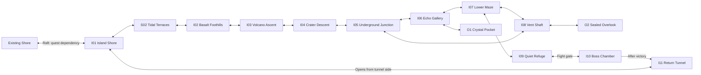

# World And Art: consolidated historical records

Merged 2026-11-07. These are dated records, **not a current task list or instructions to rerun old fix prompts**.
Current status: [implementation ledger](../../docs/IMPLEMENTATION_STATUS.md). Current tasks: [TODO](../../TODO.md).
Later delivery records can supersede earlier findings. Recorded test results describe their original run; this cleanup did not rerun gameplay.
Screenshots, logs, code probes and data remain in their original evidence directories. Original Markdown paths are compatibility redirects.

## Contents

- [reports/checkpoint-landings/README.md](#reports-checkpoint-landings-readme)
- [reports/island-connections/README.md](#reports-island-connections-readme)
- [reports/lake-caves-style/README.md](#reports-lake-caves-style-readme)
- [reports/progression-review-2026-10-30/README.md](#reports-progression-review-2026-10-30-readme)
- [reports/respawn-cleanup/README.md](#reports-respawn-cleanup-readme)
- [reports/respawn-review/README.md](#reports-respawn-review-readme)
- [reports/room-resize-2026-11-05/README.md](#reports-room-resize-2026-11-05-readme)
- [reports/traversal-and-backlog-2026-11-05/README.md](#reports-traversal-and-backlog-2026-11-05-readme)
- [docs/reviews/MAP_VARIETY_REVIEW.md](#docs-reviews-map-variety-review)
- [docs/reviews/eastern-island/BRIEF.md](#docs-reviews-eastern-island-brief)
- [docs/reviews/eastern-island/CLAUDE_REVIEW.md](#docs-reviews-eastern-island-claude-review)
- [docs/reviews/eastern-island/GRAPHICS_AUDIT.md](#docs-reviews-eastern-island-graphics-audit)
- [docs/reviews/eastern-island/MAP_PROPOSAL.md](#docs-reviews-eastern-island-map-proposal)
- [docs/reviews/eastern-island/REVIEW.md](#docs-reviews-eastern-island-review)
- [docs/reviews/platform-art/CODEX_PROMPT.md](#docs-reviews-platform-art-codex-prompt)
- [reports/art-review-2026-10-26/REVIEW.md](#reports-art-review-2026-10-26-review)
- [reports/quality-review-2026-10-27/accessibility.md](#reports-quality-review-2026-10-27-accessibility)
- [reports/quality-review-2026-10-29/accessibility.md](#reports-quality-review-2026-10-29-accessibility)

---

## Source: reports/checkpoint-landings/README.md

Original source: `reports/checkpoint-landings/README.md`. [Evidence directory](../checkpoint-landings/).

# Shared checkpoint landings · 2026-10-30

Applied `tools/prune_respawns.py --output reports/checkpoint-landings --apply`.
Removed the intermediate C6 checkpoint `(120,48)`, retaining the right-hand
point `(160,48)`. Removed one nearby redundant point each in Foothills and Vent
Shaft. Main-world total: **73 → 70**. C1's three floor points are unchanged.

`summary.json` records the application; `backup.json` contains exact original
changed-room contents. Terrain and non-checkpoint entities are unchanged.
See [the guide](../../docs/RESPAWN_POINTS.md) for the reusable process.

---

## Source: reports/island-connections/README.md

Original source: `reports/island-connections/README.md`. [Evidence directory](../island-connections/).

# Island connections · 2026-10-29

All four shores are now 120 tiles long, three times their original width.
Each shore has two interactable direction panels to neighboring shores.
North–South and East–West have no direct panel. North Shore’s original `coast_path` leads to West Shore; the other
panel leads east. North and South occupy separate map locations, with their
old vertical exits sealed. West–Foothills and East–volcano side passages remain.

Foothills connects directly to i09, Ash Passage, a 24×46 tall tunnel. The volcano
and maze move together to retain their relative offsets beside the longer West
Shore. The post-Guardian West Shore keeps its reward door and both panels.

`tests/island_routes.tscn` checks all 8 panel routes, explicit Interact gating,
safe arrivals, the post-Guardian variant, real jump/swim traversal of each new
beach stretch, and the jump-only round trip through Ash Passage.
`tests/test_island_connections.py` independently checks layout, connectivity and
panel reachability. Both shore and island link tools are idempotent.

Validation: all 8 real panel transfers, extended beach traversal, the Guardian
variant and the Ash Passage round trip pass. Eight focused Python checks pass;
entrance validation reports zero bad entrances. Gameplay and smoke checks pass.
The existing broader `test_new_fragments_and_characters_are_reachable` still
fails: its hub-start jump-only model misses the same five discoveries (three
shore fragments and two characters). This test remains unchanged.

---

## Source: reports/lake-caves-style/README.md

Original source: `reports/lake-caves-style/README.md`. [Evidence directory](../lake-caves-style/).

# Lake Caves: applying the hand-edited Deep Lake style

The source was `c4_deep_lake.json`, edited in commit `dc4b89a`: height 23 → 12,
irregular ceiling/floor silhouettes, a stepped water basin and a shorter ladder.
That commit also replaced Lake Cave's solid barrier with a shaped breakwall cluster.

This pass applies the natural rock profiles to Roar Tunnel, Lake Cave,
Cave Teeth and Cove Tunnel. Small roof recesses and shallow outcrops break up
straight corridors; Cove Tunnel gains a shallow side shelf on its water basin.
Deep Lake is preserved byte-for-byte, as is the user's Lake Cave breakwall cluster.
Room widths/heights, world positions, every border tile, hazards, platforms,
spawns, notes and collectibles are preserved. Existing compact room sizes and
maze connections make further height reduction inappropriate in this pass.

`before.json` and `after.json` record the source data; `index.html` compares the
full room geometry. Runtime captures show actual Godot artwork. `capture.tscn`
recreates those captures with disposable user data. The overview colors are
geometry annotations, not replacement game artwork.

The initial pass exposed ceiling/ledge conflicts near Cove Tunnel's pool and
Cave Teeth's roof spikes. Those outcrops were removed after the cautious model
showed they blocked forward or return traversal. Water rectangles now span the
complete empty width at each depth, satisfying the real-engine pool checks.

Room JSON remains the authoring source for these editor-style changes. The
original generator explicitly warns that regenerating named rooms discards
manual edits; it was not run or expanded to overwrite those edits.

---

## Source: reports/progression-review-2026-10-30/README.md

Original source: `reports/progression-review-2026-10-30/README.md`. [Evidence directory](../progression-review-2026-10-30/).

# Progression review — 2026-10-30

Fixed unavailable-filter removal of reachable Ape/Guardian steps, inconsistent
filtered-map summaries, ignored starting abilities, malformed URL hash failures,
and HTML injection through room titles. Added route-preserving navigation and
two-click selection of previous steps, independent tabs, compact help, and a
larger map pane.

The World Editor now launches snapshot analysis without blocking gameplay UI,
reports failures, and opens/reopens the browser viewer. Source desktop builds
require Python 3; HTML is viewed externally rather than embedded.

Validation: 15 layout/model tests, 2 worker tests, a Godot editor test including a
real child process, editor scroll and smoke scenes, and Chromium desktop/mobile
interaction assertions. Visual checks cover the viewer and editor launcher.

The reachability model remains an approximation of player movement. The unused
legacy metro renderer is cleanup debt; it was left outside these behavior fixes.

---

## Source: reports/respawn-cleanup/README.md

Original source: `reports/respawn-cleanup/README.md`. [Evidence directory](../respawn-cleanup/).

# Checkpoint cleanup · 2026-10-30

Reviewed all 47 main-world rooms and configured variants. Removed eight redundant
markers: 81 → 73. C1 retains its three agreed floor positions. Every remaining
point passes the runtime safety audit. Terrain, other entities and room layout
are unchanged. `backup.json` stores exact pre-cleanup contents for changed rooms.

`python3 tools/prune_respawns.py` previews; `--apply` applies once with a backup.
Selection uses distinct physical/door entrances and preserves the world start.
Repeating the review after cleanup reports no changes.

---

## Source: reports/respawn-review/README.md

Original source: `reports/respawn-review/README.md`. [Evidence directory](../respawn-review/).

# Respawn density review

Reduced 110 markers to 64 across base rooms and variants.
Authored checkpoints are retained. Ordinary rooms allow one point; rooms at least
80 tiles wide or 40 tiles tall allow two separated points.
Only spawn entities were removed; terrain and other entities remain unchanged.
Exact pre-edit file contents are stored in backup.json.

---

## Source: reports/room-resize-2026-11-05/README.md

Original source: `reports/room-resize-2026-11-05/README.md`. [Evidence directory](../room-resize-2026-11-05/).

# Resize rooms from any side

In the room editor, choose **Room size (drag edges)** in the left palette. Drag any edge or corner; the green preview snaps to tiles and displays the proposed dimensions. Release to apply. Escape cancels; Ctrl+Z undoes the complete change. W/H + Resize keeps its previous right/bottom behavior.

Left/top changes translate tiles, object positions, zip destinations and patrol paths together. Saving a world room also updates its manifest origin to keep existing content and the opposite edge fixed in world space. Playtest return retains the unsaved origin and undo history. Added space is empty; shrinking clips terrain/sized objects and removes outside objects. A retained patrol path or zip destination cannot be silently cropped. Limits remain 10–400 by 6–400 tiles.

## Verification

- `tests/room_resize.tscn`: 0 failures (all sides/corners, object/path translation, undo, cancellation, size constraints, world-origin persistence, custom-room saves and playtest resume).
- `tests/editor_navigation.tscn`: EDITOR NAVIGATION OK.
- `tests/editor_scroll.tscn`: EDITOR SCROLL OK.
- `tests/editor_playtest.tscn`: EDITOR PLAYTEST OK.
- `tests/smoke.tscn`: SMOKE OK; no script errors.
- `tests/test.tscn`: two existing map assertions remain: East Shore water/acid rows and the jump-only Jungle Falls bot route.
- GDScript lint and `git diff --check`: pass.
- Rendered Godot review: `handles.png` and `preview.png`. `capture.tscn` regenerates these using the actual editor.

## Conditional-room follow-up

Fixed the West Shore post-Guardian variant after a left-side expansion: matched its 163×23 dimensions and shifted its unique objects by 344 pixels using the shared doorway IDs as anchors. Editor saves now translate/crop conditional-room objects alongside the base, synchronize dimensions and terrain, validate their movement paths, and restore saved room files if a write fails. Resize-save-undo and the post-Guardian island route checks pass.

---

## Source: reports/traversal-and-backlog-2026-11-05/README.md

Original source: `reports/traversal-and-backlog-2026-11-05/README.md`. [Evidence directory](../traversal-and-backlog-2026-11-05/).

# Story traversal isolation and deferred-work audit

The jump-only traversal bot now receives a deep copy of the world without boss entities/gates, Ape chases, auto-walk, linked triggers/pressure plates, rock-fall events or notes. Conditional encounter variants are disabled in that copy. Source story files, ordinary terrain/water/platforms/spikes and dedicated encounter tests are preserved.

A blocked-jump fallback previously kept resetting its walk timer without ever allowing another jump at that position. The bot now retries after the short walk. The route terminates on arrival in Jungle Hills, before the optional downward branch that removing its gates exposes; the separate planner checks still cover its local jump geometry.

West/East Shore use manually shaped pools, like the already exempt meadow/caves. Their entity layouts are preserved and no longer required to follow the generated wall-to-wall liquid convention.

The Python island checker now derives its landing from the current raft doorway instead of the pre-move global coordinate (706, 65). The room/star/return-route assertions remain intact.

Conditional-room resizing is fixed and covered by the updated room-resize suite, including unique variant object translation, undo, and refusal to partially save when a variant-only path would be cut.

`docs/DEFERRED_WORK.md` distinguishes the explicitly postponed Ape true form, unfinished requested systems, open design decisions and old idea/optimization lists. Stale status entries for traps/triggers, input, basic attack costs and hidden walls have been corrected.

`verification.log` records the complete run and its Python follow-up: all Godot runners and linters passed; after replacing the stale island landing coordinate, all 76 Python tests passed.

---

## Source: docs/reviews/MAP_VARIETY_REVIEW.md

Original source: `docs/reviews/MAP_VARIETY_REVIEW.md`. [Evidence directory](../../docs/reviews/).

# Map variety review

Reviewed 2026-10-25. Scope: all 39 rooms in the Story manifest; changes focus
on eight repetitive eastern-island rooms. Conclusions about variety are design
judgments, not a numerical fun score.

## Findings

The world already has good regional variety: 13 room dimensions and 10 visual
themes, horizontal and vertical routes, water, forest platforming, a chase,
settlements and two distinct boss encounters. Fifteen rooms share a 40×23
footprint; that is useful for pacing and is not itself a problem. Room size
alone does not distinguish the actions a player performs inside it.

The island had three specific weaknesses:

- The ascent and east slope each used ten evenly spaced jump-through rails.
  Despite opposite travel directions, they repeated essentially the same task.
- The underground “maze” was a branching tree, with no room-level loop:
  17 island rooms, 16 traversable shared-edge links, cycle rank zero. Most
  exploration meant following one corridor and retracing it.
- Falling rocks first appeared over deep water and narrow pillars, combining
  a new hazard with precision footing before a simpler introduction.

The mainland has stronger differences between its major beats. Its remaining
issues are unfinished village interactions and some long, empty return paths.
Those need narrative/gameplay decisions rather than randomly adding hazards.

## Research and application

These are our applications of the references, not layouts copied from them:

- **Recognizable places and discovery:** Team Cherry's direct interview
  describes sketching movement and side rooms before filling in interiors,
  and building locations that make sense together. This informed the return
  loop and optional routes within the island's existing physical layout.
  [Team Cherry interview, PC Gamer](https://www.pcgamer.com/how-to-design-a-great-metroidvania-map/).
- **A room's central activity:** the GDC workshop's developer discussion
  connects memorable spaces to a mechanic or setpiece, with difficulty and
  pacing considered across adjacent rooms. This informed different movement
  rhythms for the ascent and descent, rather than adding unrelated mechanics.
  [GDC Level Design Workshop developer Q&A](https://www.gamedeveloper.com/design/gdc-2017-level-design-workshop).
- **Teach, test, twist and recovery:** the original Level Design Book pacing
  chapter recommends developing a familiar activity and alternating intensity
  with recovery. The foothills now introduce falling rocks slowly over dry
  ground; Flooded Hall later combines them with narrow footing and water.
  The existing refuge remains quiet before the boss.
  [The Level Design Book: Pacing](https://book.leveldesignbook.com/process/preproduction/pacing).

## Applied changes

| Room | Change and purpose |
|---|---|
| South Shore | Optional cliff-top route and second star above the tide pool; the lower route stays open. |
| Foothills | One falling-rock column every 3.8 seconds over dry ground, with the existing 0.6-second warning. Flooded Hall retains its faster 1.2-second emitter. |
| Volcano Ascent | Four natural rock ledges, six rail connections and existing rest shelves replace ten identical rails. |
| East Slope | Five solid descent landings and five smaller return rails create a separate movement rhythm. |
| Flooded Hall | Two contained pools flank a dry well down to Vent Shaft. The original east/west crossing remains. |
| Echo Gallery | A shallow, escapable hollow and an upper stepping route interrupt the flat floor. |
| Lower Maze | Upper reward passage under the arch and a lower corridor offer a local choice; a new star rewards exploration. |
| Vent Shaft | Climbable connection to Flooded Hall closes a four-room loop through Echo Gallery and Lower Maze. |

The island now has 17 shared-edge links across 17 rooms: one independent
room-level loop. Both new stars are reachable in the cautious jump-only model.
The loop does not bypass the boss gate. Room positions and dimensions, the
39-room manifest, mainland geometry and the single tall boss arena are unchanged.

## Validation and limits

- All island rooms and every island star are reachable in the cautious
  jump-only model; far rooms retain return routes.
- A new regression blocks Echo Gallery and verifies that Lower Maze can
  still return to Junction through Vent Shaft and Flooded Hall. It failed on
  the old map and passes on the revised map.
- Entrance and spawn safety are checked separately from map connectivity.
- See [the before/after map viewer](../../docs/reviews/map-variety.html) for actual geometry.

The Python movement model is approximate and does not simulate dynamic rocks,
enemies, or swimming energy. Engine regression tests and visual inspections
complement it; a full human traversal is still needed to judge pacing and fun.
No online guide or connectivity check can establish those by itself.

## Follow-up priorities

1. Playtest the new rockfall introduction and the length of the dry-well return.
2. Distinguish maze junctions with placed crystal/root landmarks; the current
   art-dressing helper still uses names from the previous island layout.
3. Give village rooms interactions when their NPC/quest system is ready.
4. Consider a discoverable mainland return shortcut after player testing,
   without opening the intentionally ability-gated early big jump.

Authored changes live in `tools/story/gen_island.py` as well as room JSON.
They were generated and repaired in a temporary copy first; only the eight
reviewed room files were applied to the project.

---

## Source: docs/reviews/eastern-island/BRIEF.md

Original source: `docs/reviews/eastern-island/BRIEF.md`. [Evidence directory](../../docs/reviews/eastern-island/).

# Eastern island — review brief

Status: design proposal for Claude review; no island rooms or gameplay changes implemented.
Prepared: 2026-10-25.

## Confirmed user requirements

- An island east of the current story area.
- A shore, a volcano, an underground maze, and a boss fight.
- Shore, volcano, and underground maze are areas containing at least two
  distinct rooms each. Rooms may connect horizontally or vertically.
- The boss arena is the exception: one single tall room.
- Diversify room sizes and proportions across the island; do not make every
  room the same screen-sized rectangle.
- Files prepared for Claude to review before further work.

The earlier detailed request is unavailable in this session. Everything beyond
these requirements is a proposal, not a recovered user decision.

## Existing project context

- The playable world is `worlds/story/world.json`.
- `docs/STORY_DESIGN.md`, section 1.7, describes a raft from the shore to the
  next island to the right. Lighthouse quest interaction gates the raft.
- `worlds/story/s2_shore.json` currently contains a note for that connection;
  the island is not built in this checkout.
- NPCs, dialogue, quest flags, and the raft remain dependencies documented in
  the story design. Verify actual implementation before integrating travel.
- The story starts without dash, climb, or attack. The right branch proposes
  a sword reward, but its availability must be verified before relying on it.
- Story bosses are intended to be platforming gimmick bosses.

## Proposed experience

Arrive at a calm shore with the volcano visible to the east. Climb its lower
slopes, enter a crater passage, and descend into a maze of volcanic tunnels.
Landmarks and loops make the maze learnable. Emerge at a quiet boss approach,
fight using movement and the environment, then unlock a short return route.

Use jump-only movement for the mandatory route until arrival abilities are
explicitly agreed. Dash, wall grab, sword, and heat resistance must not become
accidental requirements. A new ability reward is deliberately undecided.

## Scope of the next implementation

1. Measure default movement and energy constraints with existing test helpers.
2. Build a disposable island blockout before linking it into the story manifest.
3. Validate room transitions, return routes, maze navigation, and boss retries.
4. Add boss behavior only after its movement puzzle works in a static blockout.
5. Integrate actual raft travel and quest gating when those systems exist.
6. Add art, effects, and audio after the route is playable.

Do not edit the existing shore, regenerate existing rooms, or add the proposed
rooms to the live manifest merely to review this packet.

## Decisions for review

| Question | Proposed default |
|---|---|
| Arrival abilities? | Jump only; other abilities optional. |
| Order of areas? | Shore → volcano → underground maze → a single tall boss arena. The first three areas each have at least two rooms. |
| Maze complexity? | One main loop, two optional branches, repeated landmarks. |
| Boss concept? | Volcanic guardian defeated by baiting attacks at weak floor plugs. |
| Reward? | Leave open; dash is a candidate because the earlier big jump needs it. |
| Return travel? | Bidirectional raft after arrival; no quest repeated on return. |
| Saving and retries? | Use existing save/respawn behavior; no new save-slot system. |

## References

- `docs/reviews/eastern-island/MAP_PROPOSAL.md`: topology and room beats.
- `docs/reviews/eastern-island/CLAUDE_REVIEW.md`: review instructions and checks.
- `docs/STORY_DESIGN.md`: existing narrative and progression constraints.
- `scripts/player.gd`, `scripts/adventure.gd`: actual movement and energy rules.
- `scripts/entities.gd`: existing hazards and boss implementation.

Story notes contain historical and potentially conflicting numbers. Code and
fresh measurements should determine blockout metrics, not copied prose values.

---

## Source: docs/reviews/eastern-island/CLAUDE_REVIEW.md

Original source: `docs/reviews/eastern-island/CLAUDE_REVIEW.md`. [Evidence directory](../../docs/reviews/eastern-island/).

# Claude review handoff

Review the eastern-island design before implementation. These files were
requested by the user for review; the detailed earlier conversation was not
available when this proposal was written.

## Read first

1. Repository `AGENTS.md`.
2. `docs/reviews/eastern-island/BRIEF.md`.
3. `docs/reviews/eastern-island/MAP_PROPOSAL.md`.
4. Relevant parts of `docs/STORY_DESIGN.md`, the current story manifest, and
   movement, adventure, entity, and test code.

Stay within this project. Existing uncommitted changes predate this packet;
do not revert, stage, or rewrite them as part of review. The packet adds only
documentation and does not introduce playable rooms.

## Review questions

- Does the proposal deliver the confirmed requirements: eastern island,
  shore, volcano, underground maze, and a boss fight?
- Do the shore, volcano, and underground maze each contain at least two
  distinct rooms? Optional rooms and the return tunnel must not be used to
  satisfy their minimum counts. Is the boss arena one single tall room,
  with the refuge remaining part of the maze?
- Are room sizes and proportions meaningfully varied, with feasible horizontal
  and vertical placement? Check edge alignment and the maze's physical layout,
  rather than treating the room graph as a coordinate plan.
- Is the area order appropriate, or should the maze connect differently to
  the volcano? Treat the current topology as a proposal.
- Can every mandatory route work without dash, wall grab, or sword?
- Can energy regeneration support the ascent and boss without forcing damage
  or requiring optional upgrades? Identify measurements still needed.
- Does the maze offer meaningful exploration with enough landmarks to orient
  the player? Can all optional dead ends be exited?
- Is the proposed boss sufficiently distinct from the Ape while fitting the
  platforming-gimmick direction? Is its safe route readable and repeatable?
- Can the raft, quest gate, retry spawn, boss persistence, and return shortcut
  use existing systems? Name missing systems explicitly.
- Does the return shortcut preserve progression, including save/reload during
  arrival, the fight, victory, and return travel?
- Should the boss reward be dash, another upgrade, or deferred? Do not treat
  any reward as a confirmed user requirement.

## Requested review output

Write findings in `docs/reviews/eastern-island/REVIEW.md` when performing the
review. Start with blocking issues, then design improvements, then decisions
that need user input. Cite file paths and code evidence for technical claims.
Separate verified facts, proposals, and unanswered questions.

Conclude with a concrete recommended room graph and an implementation sequence.
Do not start implementing gameplay unless the user asks for implementation.

## Acceptance checks for later implementation

- At least two distinct rooms each in the shore, volcano, and maze, varied
  dimensions and proportions, and both horizontal and vertical connections.
- A single tall boss arena, with readable vertical combat and camera framing;
  do not split it into multiple rooms to satisfy the other areas' minimum.
- No overlap with existing room bounds; matching entrances and return exits.
- Mandatory route and maze loop traversable with default tuning and agreed
  arrival abilities; no collectible required to escape its own branch.
- Safe recovery shelves and repeatable boss attempts at minimum energy capacity.
- Boss gates close only after safe entry, open after victory, and recover
  correctly after death or reload.
- Victory and shortcut persist, with no boss bypass from the shore.
- Raft travel does not strand the player or repeat completed quest requirements.
- Run `godot --headless --path . res://tests/test.tscn` and
  `godot --headless --path . res://tests/smoke.tscn` after gameplay changes.
- Manually inspect the blockout and room transitions in the running game;
  graph connectivity and passing unit tests do not prove jump reachability.

---

## Source: docs/reviews/eastern-island/GRAPHICS_AUDIT.md

Original source: `docs/reviews/eastern-island/GRAPHICS_AUDIT.md`. [Evidence directory](../../docs/reviews/eastern-island/).

# Eastern island graphics — implementation status

Updated 2026-10-25. The original missing-art inventory is now implemented in
`scripts/island_art.gd` and exported under `assets/island/`.

## Created

- Serpent: idle, movement, warning, attack, hurt and defeat rows, four frames
  each. Connected to the current Guardian's existing eruption behavior.
- Falling-rock pack: rock, ceiling warning and breakup/impact sprite sheets.
  The dedicated falling-rock hazard behavior remains separate; this pass
  supplies graphics. The Ape's projectiles retain their earlier stone artwork
  at the user's request.
- Treetop elves and lighthouse mages: five appearances each, with idle,
  walk, talk and gesture rows. Five animated decorative inhabitants are placed
  in each village. Dialogue, quests and NPC movement are not implemented.
- Shore, volcano and volcanic cave: complete compatible terrain, corner,
  decoration and parallax packs. Assigned to the new island rooms.
- Maze landmarks: split rock, crystal formation and root arch, placed at
  selected junctions and in the crystal pocket.
- Lava surface animation, eruption, intact/broken vent plugs, raft,
  lighthouse magic flame and mirror artwork. These are connected to existing
  visual props and hazards where applicable, without changing damage rules.

## Style and constraints

Flat, angular pixel art; nearest-neighbor sampling; existing 8×8 terrain
layout and atlas formats. The approved Ape landing graphics remain unchanged.
New environment names reuse existing music scores and recordings.

## Review and maintenance

- `assets/island/preview.html`: animated gallery of every pose and appearance.
- `assets/island/manifest.json`: native sizes, row layout and provenance.
- `assets/island/README.md`: runtime integration, rebuild and limitations.
- `tools/export_island_art.gd`: deterministic source-to-PNG exporter.
- `tools/story/dress_regions.py`: repeatable visual placement pass, needed
  after existing story generators rewrite the affected room files.
- `tests/island_art.gd`: size, transparency, animation and theme checks.

The serpent artwork is integrated as a visual replacement for the former
stone-face Guardian, not a newly designed moving serpent combat system.
Raft quest gating and the lighthouse mirror puzzle are still separate gameplay
work. No claim is made that decorative villagers implement those systems.

---

## Source: docs/reviews/eastern-island/MAP_PROPOSAL.md

Original source: `docs/reviews/eastern-island/MAP_PROPOSAL.md`. [Evidence directory](../../docs/reviews/eastern-island/).

# Eastern island — proposed map

All names, topology, encounters, and rewards below are proposals. This is a
room graph, not a tile-coordinate manifest or a promise of physical adjacency.
The user requires the shore, volcano, and underground maze to be areas with
at least two distinct rooms each, horizontal or vertical placement, and
diversified room sizes. The boss arena is explicitly one single tall room.
The room sizes
below are provisional tile dimensions; jump spacing and edge openings still
need movement measurements during blockout.

## Topology

Mandatory first route: I01 → S02 → I02 → I03 → I04 → I05 → I06 → I07 → I09 → I10.
The alternative I05 → I08 → I07 route rejoins the critical path; neither maze
branch requires an item from the other. I11 is a victory shortcut, never an
entrance that lets the player bypass the boss.

## Areas and room sizes

The shore, volcano, and maze each contain multiple rooms. The boss arena is
the explicit single-room exception. Optional rooms and the return shortcut
do not count toward the minimum of two rooms in the other three areas.
Dimensions are width × height in tiles, not pixels. They propose different
spatial experiences, not fixed final geometry or measured playable jumps.

| Area | Required rooms and proposed dimensions | Arrangement and purpose |
|---|---|---|
| Shore | I01 Island Shore: 96×24; S02 Tidal Terraces: 48×36 | Wide arrival beach followed by a deeper terrace room to its east. |
| Volcano | I02 Basalt Foothills: 64×32; I03 Volcano Ascent: 40×72; I04 Crater Descent: 48×48 | Foothills east of shore; tall ascent above foothills; crater east of ascent, descending toward the maze. |
| Underground maze | I05 Junction: 48×32; I06 Echo Gallery: 80×24; I07 Lower Maze: 72×40; I08 Vent Shaft: 32×64; I09 Quiet Refuge: 32×24 | Junction and gallery form the upper route; lower maze below the gallery; vent shaft west of lower maze closes the loop to the junction. Refuge is the maze's final recovery room. |
| Boss arena | I10 Boss Chamber: 40×80 | One uninterrupted tall room, with vertical ledges and the complete fight inside it. No subdivision into additional boss rooms. |

Additional rooms: I11 Return Tunnel (112×24), O1 Crystal Pocket (24×32),
and O2 Sealed Overlook (40×24). These are supplementary, not substitutes
for the required area rooms. Total proposal: 14 rooms, including 11 required
area rooms, one return room, and two optional rooms.

Horizontal and vertical relationships above describe intended map placement.
Choose exact coordinates and matching edge spans together during blockout;
different room heights do not imply that their floors automatically align.
Check the whole maze loop for a feasible, nonoverlapping physical embedding.
The long return connection needs an explicit placement/door decision; the
graph does not imply that one straight room can cross occupied map space.

## Room beats

Intensity is a design target from 0 (rest) to 1 (climax), not runtime data.

| ID | Room purpose | Proposed play | Intensity |
|---|---|---|---|
| I01 | Island Shore | Safe arrival, visible volcano, raft return, regeneration space. | 0.1 |
| S02 | Tidal Terraces | Explore the coastal area through stepped rock shelves; dry mandatory route and a clear view inland. | 0.3 |
| I02 | Basalt Foothills | Short ordinary jumps; preview the volcanic terrain safely. | 0.3 |
| I03 | Volcano Ascent | Alternating ledges and safe shelves; readable climb toward crater. | 0.6 |
| I04 | Crater Descent | Reveal the underground route; every drop has a jump-only way back. | 0.3 |
| I05 | Underground Junction | Central landmark: bright split rock with two distinct exits. | 0.2 |
| I06 | Echo Gallery | Upper maze route, occasional enemies, crystal landmark. | 0.5 |
| I07 | Lower Maze | Routes converge at a recognizable root/rock arch; reveal refuge. | 0.6 |
| I08 | Vent Shaft | Alternate vertical route; safe shelves; loop back to junction. | 0.5 |
| I09 | Quiet Refuge | Safe energy recovery and room spawn before boss; no new bench system. | 0.1 |
| I10 | Boss Chamber | Test jump timing, positioning, and environmental attack baiting. | 1.0 |
| I11 | Return Tunnel | Low-pressure reward route; open persistent shortcut to shore. | 0.1 |
| O1 | Crystal Pocket | Short dead end with optional collectible and clear return. | 0.3 |
| O2 | Sealed Overlook | Optional view back to the island; collectible, no required progression. | 0.2 |

Use proposed IDs as labels until room naming conventions are selected. Reserve
an eastern area in the world grid only after checking existing room extents;
do not infer free space from room origins alone.

## Maze readability

- Give I05, I06, and I07 different silhouettes as well as color cues.
- Show exits within camera view before asking the player to choose.
- Keep optional dead ends short and reward them; avoid long empty wrong turns.
- Let the loop provide a second route, rather than making identical corridors.
- Place a recognizable landmark on both sides of each inter-room connection.
- Darkness and decorative tunnels must not hide collision boundaries.

## Boss proposal: volcanic guardian

Placeholder identity; not the existing Ape and not an approved final design.

The guardian telegraphs a ground strike aimed at the player's position. The
player baits it onto a visible weak floor plug, then jumps to a safe ledge.
A successful strike breaks the plug and vents pressure into the guardian.
Three successful baits are a proposed starting point for tuning.

1. First plug: generous telegraph, nearby safe ledge, one attack at a time.
2. Second plug: different position; require crossing the arena between attacks.
3. Third plug: combine familiar movement with a shorter recovery, retaining
   a safe route and a clearly visible wind-up.

The guardian's body must not block access to all safe ledges. Broken plugs
must never remove the last traversable floor or turn retry spawns lethal.
Use the arena's height for reachable ledge tiers and movement between attack
cycles, with safe routes up and down. Keep the entire encounter in I10;
camera tracking must reveal telegraphs and landing targets without requiring
offscreen jumps. The floor-plug concept is provisional and must be reviewed
for compatibility with this tall arena rather than implying a wide flat fight.
No sword, dash, wall grab, or mandatory damage is required. Avoid adding
continuous energy drain: repeated jumps already spend energy.

On defeat, keep the boss beaten, release fight gates, and expose I11. Reward
selection remains open. Reuse existing persistence conventions if possible;
new floor-plug, boss, and shortcut state are implementation dependencies.

## Geometry and retry constraints

- Measure jump height, elevated-landing reach, collider clearance, and energy
  recovery using default tuning at the project's 60 Hz physics timestep.
- Keep required jumps comfortably within measured reach; reserve tight jumps
  for optional collectibles. Do not use ideal ballistic formulas as proof.
- Provide safe standing shelves between mandatory jump sequences so the route
  works from minimum arrival capacity without optional energy pickups.
- Avoid forced underwater travel and new lava damage rules in the first blockout.
  Existing hazards can stand in until volcanic mechanics are approved.
- Boss entry must reliably establish a safe retry spawn using existing room
  behavior. Verify whether I09 or I10 should own it before implementation.
- Death during the fight resets temporary arena changes. Victory persists;
  returning to the island must not relock the shortcut or retrigger the fight.
- A test-only entrance may bypass the unimplemented raft for development; it
  must not silently become the story's player-facing travel mechanism.

---

## Source: docs/reviews/eastern-island/REVIEW.md

Original source: `docs/reviews/eastern-island/REVIEW.md`. [Evidence directory](../../docs/reviews/eastern-island/).

# Eastern island — review

**Status: built as a blockout on 2026-10-25** with the recommended defaults (boss 40×46, door shortcut, raft door,
no reward). Room IDs: i01..i13 (`tools/story/gen_island.py`).

Reviewed 2026-10-25 against `BRIEF.md`, `MAP_PROPOSAL.md`, `docs/STORY_DESIGN.md`, `worlds/story/world.json`
and the code. Labels: **[fact]** checked in code or measured; **[proposal]** a recommendation; **[question]** for the user.

## Measurements (default tuning, 60 Hz, headless probe on a flat test level)

- **[fact]** Full held jump from a full run: apex **29 px (3.6 tiles)**, airtime **0.67 s**, flat distance **63 px (7.9 tiles)**.
  Constants in `scripts/player.gd` (`JUMP_SPEED -105`, `GRAVITY 900`, `MAX_RUN 90`).
  Blockout rule: required rises ≤ 3 tiles, required gaps ≤ 5 tiles; 6-7 tile gaps only for optional pickups.
- **[fact]** Energy (as of today's change): base **20**, jump **2.5**, regen **6/s** everywhere outside water, also mid-air
  (`World.update_energy`, `scripts/world.gd:628`; `Adventure.regen_energy`). A jump regains 6 × 0.67 ≈ 4 energy in the
  air, more than the 2.5 it costs. **Chained jumps on land never run out**; energy limits only water and very fast
  repeated short hops. The proposal's "energy regeneration supports the ascent" is satisfied by construction; recovery
  shelves are a pacing tool, not an energy need. Respawn refills the base bar (`World.respawn`).
- **[fact]** Map space: existing rooms end at x = 679 tiles (Shore, Lighthouse Top), y spans -14..137. Everything from
  x ≥ 700 is free. The coordinates below were checked by script: no overlap with existing or new rooms.

## Blocking issues

1. **Boss plumbing is Ape-only.** [fact] `BossGate` and `AutoWalk` decide with `Ape.alive_in(w)`, which only finds
   `e is Ape and not e is ApeChase` (`scripts/entities.gd`, class `Ape.alive_in`, `BossGate.update`, `AutoWalk.touch`).
   A new boss can't lock gates or trigger the walk-in. Needed: a shared `boss_alive(w)` (any entity with a `boss`
   flag, not gone). Small change, but it must come first.
2. **No raft, NPC or quest flags.** [fact] `grep raft|quest scripts/` finds nothing; `STORY_DESIGN.md` §Systems lists
   NPCs, dialogue and quest flags as not built. **Existing parts that cover most of it:**
   - travel: the cross-room `door` entity (`"to": "room:id"`, `World._go_door`, `scripts/world.gd:425`) can be the raft,
     with no long room in between;
   - gating: `world.json` `"variants"` swap a room when an id is in the run's `broken` set
     (`Adventure.room_level`, used by the Ape arena). A quest flag can be one more id in that set, so "raft usable" is a
     Shore variant with the door. Missing is only the thing that writes the flag (an NPC talk).
   Until then: a dev-only door, never in the shipped Shore (as the brief says).
3. **An 80-tile boss room is 3.5 screens tall.** [fact] One screen is 40×23 tiles (`docs/WORLD_DESIGN.md`). Telegraphs
   and landing targets more than ~11 tiles above or below the player are off screen, which fails the acceptance check
   "camera framing … without offscreen jumps". [proposal] **40×46** (two screens): still clearly tall, ledge tiers
   fit, every attack readable. [question] keep 80 with a zoomed-out camera for this room (new camera rule), or go to 46?
4. **I11 Return Tunnel (112×24) can't be placed** as one straight room without crossing the maze or the sea gap.
   [proposal] Drop it. After victory the boss room's variant opens a `door` back to I01 (and I01's variant gets the
   matching door). Both use existing systems, persist via `broken`, and give no way in from the Shore before the fight.
5. **Touching rooms open automatically.** [fact] Two rooms that share an edge get a passage wherever both sides have
   open tiles (README, World editor). In the embedding below every touching pair is an intended link, but the shared
   spans are long (I06/I07 share 72 columns, I07/I08 32 rows): only the passage tiles may be open, the rest of each
   edge must stay solid. `tools/check_entrances.py`
   and the room-safety tool should run on the island before linking.

## Design improvements

- **Order is right**: shore → volcano → maze → boss, matching the climb-up-then-down shape. The maze joining the
  volcano through the crater floor (vertical) is better than a side door: the descent is the reveal.
- **Area minimums**: Shore 2 (I01, S02), Volcano 3 (I02-I04), Maze 5 (I05-I09); optional rooms and the shortcut are not
  counted. Refuge stays in the maze. Boss is one room. Sizes vary (24-96 wide, 24-72 tall). ✔
- **Maze loop**: junction → gallery → lower maze → vent shaft → junction works physically (embedding below).
  Every drop into the lower maze or a dead end needs a way back up within 3-tile rises; the vent shaft
  (32×64) is the natural climb back, so put shelves every 3 tiles there.
- **Landmarks**: give each junction a silhouette (split rock in I05, crystal in I06, root arch in I07) and repeat the
  next room's landmark at the doorway, as the proposal says. Use the map (M) explored state as the second aid.
- **Boss** (volcanic guardian, floor plugs): distinct from the Ape (it stays put and strikes where you stand, the Ape
  leaps and throws). In a tall room, put plugs on **three tiers**: bait on the floor, then a mid ledge, then a high
  ledge, with the safe ledge always one ≤3-tile jump away. Broken plugs become solid rubble, never holes, so the
  retry spawn and floor stay safe. Reuse: kill on contact (`Player.die`), `burst`/`shake_dir`, `spawn_entity`,
  victory persistence via `break_wall(id)` (same as the Ape). Retry spawn: I09 Refuge owns it (`World.safe_spawn`
  already rejects hazards); the boss room's own spawn sits behind the entry gate.
- **No lava rules yet**: use `acid` as the stand-in for lava (exists, kills on touch).

## Recommended room graph and coordinates (tiles; checked for overlap)

| Room | Size | Position | Connects |
|---|---|---|---|
| I01 Island Shore | 96×24 | (700, 46) | raft door ↔ Shore; east edge → S02; after victory: door from boss |
| S02 Tidal Terraces | 48×36 | (796, 34) | west ← I01; east → I02 |
| I02 Basalt Foothills | 64×32 | (844, 38) | west ← S02; top (cols 868-907) → I03 |
| I03 Volcano Ascent | 40×72 | (868, -34) | bottom ← I02; east edge (rows -30..17) → I04 |
| I04 Crater Descent | 48×48 | (908, -30) | west ← I03; floor (cols 916-955) → I05 |
| I05 Underground Junction | 48×32 | (916, 18) | top ← I04; east → I06; floor (cols 940-963) → I08 |
| I06 Echo Gallery | 80×24 | (964, 18) | west ← I05; floor → I07; ceiling (cols 990-1013) → O1 |
| I07 Lower Maze | 72×40 | (972, 42) | top ← I06; west ← I08; east → I09 |
| I08 Vent Shaft | 32×64 | (940, 50) | top → I05; east → I07; west → O2 |
| I09 Quiet Refuge | 32×24 | (1044, 58) | west ← I07; east (gate) → I10 |
| I10 Boss Chamber | 40×46 | (1076, 36) | west ← I09 (boss gate); after victory: door → I01 |
| O1 Crystal Pocket | 24×24 | (990, -6) | floor → I06 (dead end, drop back down) |
| O2 Sealed Overlook | 40×24 | (900, 80) | east → I08 (dead end) |

Horizontal links: I01-S02-I02, I03-I04, I05-I06, I08-I07, I07-I09-I10, O2-I08.
Vertical links: I02-I03, I04-I05, I05-I08, I06-I07, I06-O1.

## Decisions for the user

1. Boss room height: 46 (recommended) or 80 with a special camera?
2. Boss reward: dash (opens `m2_big_jump`'s gap), something else, or none for now? Nothing is assumed.
3. Return: door shortcut after victory (recommended) instead of the 112-wide tunnel?
4. Raft before NPCs exist: dev-only door now, real raft + quest flag later?
5. Energy is no longer a limit for jumping on land (see Measurements). Is that intended for the island, or should
   regen pause mid-air?

## Implementation sequence

1. Generic boss check (`boss_alive`) for `BossGate`/`AutoWalk`; keep the Ape tests green.
2. Generator script for the island (`tools/story/gen_island.py`, same `Room` helpers), blockout only, rooms placed as
   above, unlinked edges walled; dev door from the Shore.
3. Checks: `world_fixups.py`, `check_entrances.py`, room safety; a test that walks the mandatory route with the
   test runner's Bot (jump-only, default tuning), plus the maze loop both ways.
4. Boss in a static blockout: plugs, tiers, telegraph; then the attack loop; then victory → `break_wall(id)`,
   variants for I10 (open gate) and I01 (shortcut door). Tests for death reset, reload mid-fight, victory persistence,
   no Shore-side entry before victory.
5. Raft as a Shore variant door once a quest flag exists (NPC talk writes the id).
6. Art, `acid`→lava visuals, music key for the island, sounds.

---

## Source: docs/reviews/platform-art/CODEX_PROMPT.md

Original source: `docs/reviews/platform-art/CODEX_PROMPT.md`. [Evidence directory](../../docs/reviews/platform-art/).

# Codex prompt: a jump-through for each environment

Read `AGENTS.md` and `assets/README.md` (the art layout standard) first. Stay inside this repository. Do not change
gameplay, collision, room files or generators. Use the `pixel-art-studio` skill for the sprites.

## Context (verified in code, 2026-10-28)

- There is one one-way platform type, `jumpthru` ("Jump-Through", `class JumpThru` in `scripts/entities.gd`). The
  former Leaf Platform is now a jump-through with the jungle look (old `"leaf"` data converts on load).
- Behaviour: land on it from above, jump up through it, down + jump drops through.
- Collision: `rect` is `w` px wide (a multiple of 8, about 16 to 80) and **5 px tall** (`JumpThru.setup`); the room
  file stores `h: 8`. The rect's top edge is the standing surface.
- **Look**: `JumpThru.look()` returns `d.look` if the platform sets one, else the room's `environment`
  (`World.data.environment`; in the editor, `JumpThru.editor_look`). `JumpThru.draw` picks the art from it:
  today `forest` draws procedural leaves (`_draw_leaves`), everything else the plank rail
  (`BlockArt.draw(ci, rect, "jumpthru")`, `scripts/block_art.gd`).
- Environments (`EnvironmentArt.THEMES`, `scripts/environment_art.gd`): `sand`, `sea`, `cavern`, `cavern_deep`,
  `sky`, `temple`, `building`, `forest`, `island_shore`, `volcano`, `volcanic_cave`; plus `""` (editor levels
  with no environment). Their terrain, backgrounds and decorations are in `assets/themes/<environment>/`.
- Jump-throughs in the story today, by look: volcanic_cave 46, island_shore 24, forest 22, temple 13, volcano 11,
  cavern_deep 10, building 4, sea 2 (sand, cavern, sky: none yet, but give them one).

## What to make

One jump-through design per environment (12 looks: the 11 environments and `""`), each matching its
environment's terrain palette and materials, for example: driftwood or coral (sea, island_shore), sandstone slab
(sand), mossy stone ledge (cavern), dark crystal shelf (cavern_deep), cloud or rope bridge (sky), carved stone
(temple), wooden shelf or beam (building), leaves on a branch (forest, keep the current idea), cooled basalt
(volcano), obsidian with a faint glow (volcanic_cave), the current plank rail (`""`).

For every look:
- **Collision honesty**: the top surface line is the rect's top edge; nothing solid-looking above it. Decoration
  may hang at most 3 px below the 5 px rect, never wider than the rect.
- **Tiling**: any width that is a multiple of 8: left cap, repeatable 8 px middle, right cap; no seams.
- **Readable as one-way**: a thin, light top edge and an open or airy underside, so it never reads as a solid block.
- Pixel art at native scale (1 art px = 1 game px), limited palette, nearest filtering, consistent light from the
  top-left like the rest of the game.
- Optional, subtle idle motion (max 1 px, 2-4 frames) only where it fits (leaves, cloud, glow).

## Deliverables

- `assets/platforms/<look>.png` (one sheet per look: row 0 = left cap, middle tiles, right cap as 8x8 cells; extra
  rows for animation frames) and `assets/platforms/manifest.json` (cell size, columns, frames per look), a
  `README.md` and a `preview.html` showing every look at widths 16, 24, 40, 80, following `assets/README.md`.
- Drawing: `JumpThru.draw` keeps its signature; draw the sheet for `look()`, falling back to the plank rail for an
  unknown look. Cache textures by look and width.
- A check runner like `tests/island_art.gd`: one sheet per environment, exact cell sizes, transparent background,
  art top row at the rect's top, nothing outside the allowed bounds, animation frames distinct where animated.
  Add it to `tools/verify.sh` with a success line.
- `sh tools/verify.sh` at 0 failing; one dated line in `gdd.txt`.

## Out of scope

Behaviour or collision changes, editing room files, new environments, sound.

---

## Source: reports/art-review-2026-10-26/REVIEW.md

Original source: `reports/art-review-2026-10-26/REVIEW.md`. [Evidence directory](../art-review-2026-10-26/).

# Bethe Knight art review — 2026-10-26

Verdict: **FIX for visual consistency; preserve the existing character and environment foundation.** The largest gains come from consistent pixel presentation, clearer one-way platforms, and bringing the island scenery up to the older packs' standard.

Review uses pixel-art-studio's silhouette, cluster, palette, lighting, outline, animation, and export checklist. This is a review, with no production artwork or gameplay changes.

## Evidence and scope

- Inventoried 135 PNG files under `assets/`, including historical previews. Measured 114 non-preview/non-contact-sheet PNGs in [asset-stats.tsv](../art-review-2026-10-26/asset-stats.tsv).
- Visually inspected all 11 theme previews, terrain and decoration atlases, Nori's 13 pose rows, all 32 enemy rows, all six ape pose rows, the island pack, special-block examples, and legacy Paper Pixels sheets. Historical before-images are reference material, not the proposed visual target.
- Inspected procedural rendering in `art.gd`, `character_art.gd`, `enemy_art.gd`, `ape_art.gd`, `island_art.gd`, `block_art.gd`, `environment_art.gd`, `entities.gd`, and player drawing; reviewed gameplay/UI captures from the existing smoke runner.
- Captured 14 settled standalone room examples: ten themes used by the loaded story plus village, lighthouse, crater and crystal pocket. The unused-in-this-run `cavern` theme is covered by its exported preview. See [runtime overview](../art-review-2026-10-26/runtime-overview.png).
- Used the skill's `Sprite.from_png`, `stats()` and silhouette export on Nori, ape, serpent and a one-way rail. These have 11, 10, 9 and 6 visible colors respectively, no partial alpha and no near-duplicate colors under the skill's heuristic. Nori has one isolated pixel at atlas `(28,101)` in wall-slide frame 1: inspect the intended hand-drag pose before removing it.
- Read [the platform brief](../../docs/reviews/platform-art/CODEX_PROMPT.md) as requested. Its art/collision constraints are incorporated below.

Limitations: static frame inspection does not certify animation timing or every gameplay state. The smoke run exercised motion but no frame-by-frame motion recording was made. Settled captures use standalone playtests, so they do not establish adventure progression or dialogue behavior. The village's missing-door message in that capture is a standalone-context artifact, not evidence of a broken adventure door. The display manager produced 1280×1432 captures despite a requested 1280×720 window; black margins and HUD placement in those captures are not treated as native-resolution defects. Overview sheets are reduced navigation aids; inspect source PNGs/full screenshots for pixel judgments.

## Prioritized findings

### 1. High — fractional rendering undermines otherwise clean pixels

`scripts/world.gd:24` sets `ZOOM = 4.8`. Nearest filtering is correctly configured, but 1 source pixel cannot occupy a uniform integer number of screen pixels at this zoom. `scripts/environment_art.gd:56` also stretches a 320×180 painting to `view.size * 1.2`; at the nominal view this is approximately 320×180, with a different effective scale from terrain. Camera/character transforms introduce further fractional movement and squash.

Recommendation: evaluate an integer-scaled low-resolution world viewport, with UI rendered separately. Preserve the intended camera framing explicitly rather than merely replacing 4.8 with 4, which changes how much of the level is visible. Keep squash/stretch as a deliberate animation exception. Acceptance: compare a stationary scene, slow pan, run and jump at target resolutions; stationary terrain and background clusters should retain consistent screen-pixel widths.

### 2. High — one-way platforms do not explain their shared behavior

`JumpThru.draw` uses the enclosed beveled `jumpthru` slab; `Leaf.draw` paints segmented green bars. The generic object resembles a solid miniature block; the leaf lacks a convincing leaf silhouette. Both allow passage from below, but the art offers little shared indication of this.

Follow `docs/reviews/platform-art/CODEX_PROMPT.md`: keep the top at `rect.position.y`, never draw solid-looking pixels above it, never exceed its width, retain the 5px collision height, and allow only up to 3px of decorative underside. Use a clear lit standing edge with an open/light underside, capped seamless sections, and broad connected leaf clusters. A restrained material palette per environment would integrate the rail better than the current universal pale cyan bevel.

Acceptance: widths 16/24/40/80 across all eleven environments; leaves read as organic at native size; both types communicate one-way passage. Preserve the draw call sites and physics. The brief also requires an original-asset README, preview page, bounds checks, verify-runner integration and a dated `gdd.txt` note when implemented. No implementation is included in this review.

### 3. High — the three island themes look like an earlier production stage

Compare [theme overview](../art-review-2026-10-26/themes.png), [materials](../art-review-2026-10-26/materials.png), and `runtime/settled_island_shore.png`. Island terrain uses three colors and a strongly repeated hooked mark. All three packs reuse closely related rock decorations; shore/volcano backgrounds are dominated by the same cone and detached horizontal smoke bars. `volcanic_cave` has large rectangular teeth and a single arch, with little intermediate detail. Forest, building and temple have richer material language and depth.

Recommendation: retain angular silhouettes and quiet backgrounds, but add irregular connected rock strata, distinct shore/basalt/cave props, overlapping ash clusters, and two or three depth bands. Break motif repetition across wider areas rather than adding random single-pixel noise. Start with value grouping; adding colors alone will not solve this.

### 4. Medium — new humanoids are readable by costume but less modeled than Nori

Elves read through ears/headwear; mages through hats and robes. Their broad flat faces and rectangular torsos have fewer internal landmarks than Nori. In `runtime/settled_s3_lighthouse_top.png`, the pale beacon overlaps the light clouds in value; green villagers also compete with the forest palette.

Recommendation: strengthen one face/hand cluster, a darker far-side sleeve or leg, and one coherent shadow edge. Preserve native size, variant silhouettes and foot baseline. Give the beacon a darker backing/base separation without making the whole prop brighter. Avoid a global black outline pass: Nori already works primarily through colored clusters.

### 5. Medium — enemy variants need stronger behavioral identification

The nine base families have useful silhouette variety, especially Cragjaw, Murkspore and the skeleton. However, swift, shielded and other variants often share almost the same silhouette, relying on tint or very small marks. The source adds shoulder plates, brood spots and venom drips, but these are subtle at play size. See [all enemy rows](../art-review-2026-10-26/enemies-detail.png).

Recommendation: reserve one visible shape cue per dangerous distinction: a leading shield plate, a swept posture/fin, or a larger persistent venom sac. Judge in grayscale and against each assigned biome. Keep established collision bounds; don't imply protection or reach that behavior doesn't provide. Four-frame cycles generally make small pose changes; stronger contact/compression differences would improve weight for the heavier families.

### 6. Medium — serpent attack poses have less force than its scale suggests

The serpent has a clear S-neck and right-facing head with a compact nine-color palette. Warn/attack change head height and mouth, while coils remain largely fixed; the much smaller ape has stronger crouch/airborne/throw/run silhouette changes.

Recommendation: exaggerate anticipation through neck compression and jaw opening, then recovery through a distinct neck bend. Keep warning/eruption timing and combat bounds unchanged. Check the runtime destination rectangle before adding detail: Guardian drawing resizes the whole native 96×64 image to its entity rect, which can alter the intended proportions for other placements. This is a placement-dependent risk, not a confirmed defect in every room.

### 7. Medium — primitives and authored sprites use different visual languages

White triangular spikes are exceptionally legible. Refill diamonds, circular boosters/bumpers, rings, water rectangles, gates, notes and fragments use simpler procedural geometry alongside modeled pixel sprites. Several effects use fractional coordinates/radii. This is especially apparent around the ape's large thin circular effect and the saturated diamonds in the smoke room.

Recommendation: preserve the successful hazard silhouettes, then standardize a small set of native-grid edge weights, highlight placements and sparkle shapes. Give interactable fragments a distinctive shard silhouette and prompt treatment so they cannot be mistaken for passive refills. Preserve three-fragments-per-upgrade behavior and the project's interactable-discovery direction; do not introduce replacement stars.

### 8. Medium/low — menus communicate tools better than the game's identity

Main menu, pause, options, map, editor and Music Studio use readable system-style controls, but the title screen has no authored mountain/character composition. Map markers are largely small colored dots; the editor sidebar distinguishes many entries by text/color rather than miniature art. See [UI overview](../art-review-2026-10-26/ui-overview.png) and `runtime/menu.png`.

Recommendation: add one restrained pixel-art title composition and consistent illustrated category/interaction icons. Retain readable UI text; a pixel font is optional. Keep technical editors functional and separate from the world palette. Give important map marker categories shape differences, then inspect actual-size legibility and keyboard focus states.

## Coverage and disposition

| Group | Keep | Next improvement |
|---|---|---|
| Nori, 13 states | Small palette, backpack identity, coherent near/far legs, authored air poses | Check wall-slide isolated pixel and animation in motion; avoid wholesale redraw |
| Ape, six poses | Strong profile, arm/knuckle mass, recognizable pose changes | Verify telegraphs and thin effects against both cave and forest |
| Enemy families/variants | Distinct base species; expressive jaw and cap silhouettes | Behavioral variant shapes and weight/contact poses |
| Sand / sea | Warm/cool distinction, clear terrain tops | Reduce material repetition; expand cactus/coral prop silhouettes |
| Cavern / cavern_deep | Quiet values, crystal accents, readable surfaces | Differentiate more than darkness; avoid losing dark enemies |
| Sky | Calm stepped clouds and clean surfaces | Preserve foreground separation on light clouds |
| Temple | Pillar rhythm, architectural material | More broken/offset motifs so repeated pillars feel less uniform |
| Building | Timber houses, pitched roofs, fence/wheat language | Interior-specific scenery where the room is inside a house |
| Forest | Layered trunks, canopy, roots, restrained depth | Better villager contrast; leaf platform silhouette |
| Island shore / volcano / volcanic cave | Clear broad biome colors | Highest-priority environment refinement, described above |
| Breakwall / crumble / falling / zip | Continuous perimeter across arbitrary sizes; good material separation | Strengthen small-size symbols; reduce common box framing where behavior differs |
| Dream blocks | Strong dark field, star motion and perimeter identity | Review actual runtime art; teal exports are explicitly unused references |
| Island props | Raft sail, mirror and landmark silhouettes | Root arch thickness/material and beacon background separation |
| Rock / warning / impact / eruption / lava | Simple danger colors and hard alpha | More expressive breakup/eruption clusters; distinguish visual states without noise |
| Legacy Paper Pixels | Useful compact terrain vocabulary; retain license | Treat unused legacy player and before-images as references, not cleanup targets |
| HUD / prompts / map / touch controls / editors | Clear labels and keyboard/pad prompts | Shared icon vocabulary, native-size marker tests, restrained title artwork |

## Suggested order and verification

1. Establish pixel presentation and camera-framing policy.
2. Implement the narrowly scoped platform brief.
3. Refine the island materials/backgrounds and NPC separation.
4. Strengthen enemy/boss pose and variant cues.
5. Unify effects, interaction icons and title-screen identity.

For artwork revisions use the established GDScript authoring/export sources rather than editing derived PNGs. Require native-size and integer-enlarged previews, grayscale/silhouette checks, and a motion review for animations. Do not apply a single color budget to the entire enemy atlas: 89 colors across 32 variants is not itself palette bloat. The only measured partial-alpha source here is the legacy `assets/paper-pixels/Player.png` (118 pixels); that does not establish a current player-rendering issue.

The existing rendered smoke runner exited 0 with `SMOKE OK`; it emitted an ApeChase path warning in its synthetic fixture. The additional capture runner exited 0 with `ART CAPTURE OK`. No production code changed, and no gameplay-suite pass is claimed. The verification-before-completion skill is used to check these results and the review artifacts before delivery.

---

## Source: reports/quality-review-2026-10-27/accessibility.md

Original source: `reports/quality-review-2026-10-27/accessibility.md`. [Evidence directory](../quality-review-2026-10-27/).

# World accessibility audit

World: `worlds/story`. Start: `m1_meadow`. 39 rooms; 12 door entities.

This is a static connectivity test, **not a physics playthrough**. It ignores gravity, jump/dash reach, stamina, and return paths. Crouch models allow a one-tile body everywhere; standing requires two vertical tiles (conservative for the actual 8×11px hitbox). Breakable walls are assumed broken. Hazard rectangles are rounded outward to tiles; spikes are treated as lethal from every direction. Doors allow any valid target tile, rather than reproducing the runtime arrival offset. No enemies or moving entities are simulated, and temporary travel above room tops is omitted. Results identify routes to investigate; neither green cells nor flagged rooms establish live traversability.

Map: green = standing model; blue = crouch model only; amber = topology only; red = disconnected even without hazards.

| Model | Reached rooms | Unreached rooms |
|---|---:|---|
| topology | 39/39 | None |
| acid | 39/39 | None |
| hazards | 39/39 | None |
| standing | 39/39 | None |

## Rooms flagged by hazard or standing models

| Room | World tile origin | Markers | Flags |
|---|---|---|---|

---

## Source: reports/quality-review-2026-10-29/accessibility.md

Original source: `reports/quality-review-2026-10-29/accessibility.md`. [Evidence directory](../quality-review-2026-10-29/).

# World accessibility audit

World: `worlds/story`. Start: `m1_meadow`. 47 rooms; 20 door entities.

This is a static connectivity test, **not a physics playthrough**. It ignores gravity, jump/dash reach, stamina, and return paths. Crouch models allow a one-tile body everywhere; standing requires two vertical tiles (conservative for the actual 8×11px hitbox). Breakable walls are assumed broken. Hazard rectangles are rounded outward to tiles; spikes are treated as lethal from every direction. Doors allow any valid target tile, rather than reproducing the runtime arrival offset. No enemies or moving entities are simulated, and temporary travel above room tops is omitted. Results identify routes to investigate; neither green cells nor flagged rooms establish live traversability.

Map: green = standing model; blue = crouch model only; amber = topology only; red = disconnected even without hazards.

| Model | Reached rooms | Unreached rooms |
|---|---:|---|
| topology | 41/47 | `hub_landing`, `w1_wilds_gate`, `w2_wilds_hollow`, `w3_wilds_roots`, `w4_wilds_den`, `w5_wilds_drop` |
| acid | 41/47 | `hub_landing`, `w1_wilds_gate`, `w2_wilds_hollow`, `w3_wilds_roots`, `w4_wilds_den`, `w5_wilds_drop` |
| hazards | 41/47 | `hub_landing`, `w1_wilds_gate`, `w2_wilds_hollow`, `w3_wilds_roots`, `w4_wilds_den`, `w5_wilds_drop` |
| standing | 41/47 | `hub_landing`, `w1_wilds_gate`, `w2_wilds_hollow`, `w3_wilds_roots`, `w4_wilds_den`, `w5_wilds_drop` |

## Rooms flagged by hazard or standing models

| Room | World tile origin | Markers | Flags |
|---|---|---|---|
| `hub_landing` | [-40, 0] | You land here. Left: the Western Wilds. Right: the meadow. | topology, acid, hazards, standing |
| `w1_wilds_gate` | [-80, 0] | — | topology, acid, hazards, standing |
| `w2_wilds_hollow` | [-120, 0] | — | topology, acid, hazards, standing |
| `w3_wilds_roots` | [-80, 23] | — | topology, acid, hazards, standing |
| `w4_wilds_den` | [-120, 23] | — | topology, acid, hazards, standing |
| `w5_wilds_drop` | [-40, 23] | — | topology, acid, hazards, standing |
